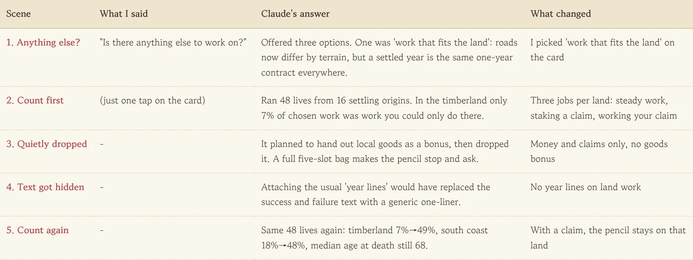
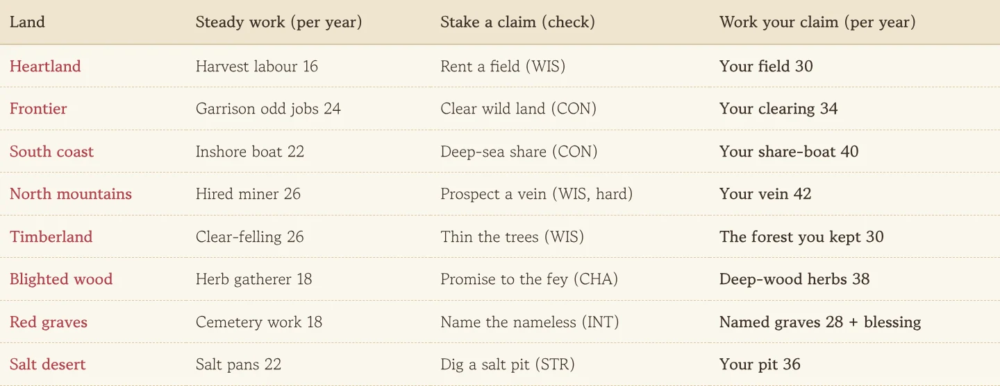
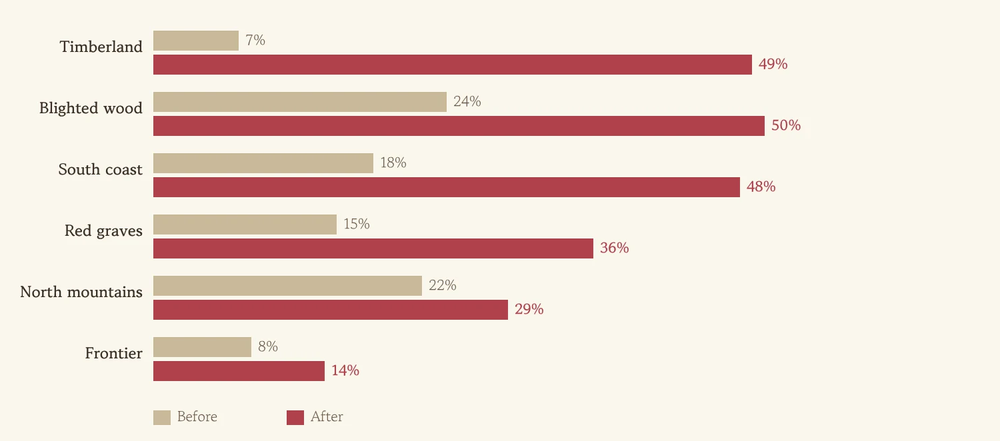
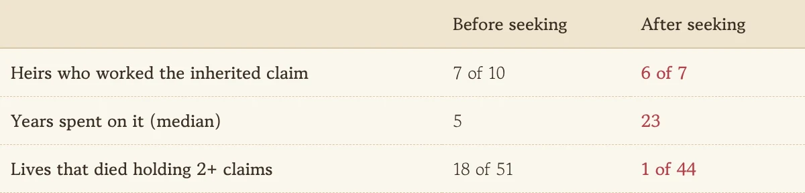

With boat-only routes and a desert you can only cross by caravan, travel finally felt tied to the land. Then I caught my breath, looked at the screen again, and noticed something off. On the road everything had changed, yet the moment you settled down in any town, a year in the timberland and a year on the coast both turned into the same "one-year contract job." Different stage sets, same script.

<figure><figcaption>I really only said the first line. Claude did the counting, the fixing and the counting again.</figcaption></figure>

## "Is there anything else to work on?"

Wrapping up the terrain work over coffee, I tossed a casual question at Claude: "Is there anything else to work on?" Up came three cards, and one of them was **"work that fits the land."** The diagnosis hit the exact nerve I'd been feeling: wandering lives now changed with the terrain, while settled lives kept ordering off the exact same menu everywhere. I clicked that card. Honestly, my share of the work was pretty much over right there.

## Numbers before fixes

Thankfully, Claude didn't dive straight into rewriting code. It counted first. It picked 16 stay-put origins—miner clans, lumberjack families, dock porters—let the pencil (autoplay) live 48 lives, and measured what share of an adult's chosen work could only happen on that specific land.

The numbers were bleak. Timberland 7%, frontier 8%, south coast 18%. You could be born into a lumberjack family with an axe in your cradle and still spend nine years out of ten working the same generic contract job as everyone else. It was like filming in a logging camp while the actors sat at desks doing spreadsheets. Hearing "7%" hits a lot harder than just feeling "it's a bit flat."

## Three jobs per land, and a claim of your own

The prescription was three one-year jobs tailored to each terrain:

1. **Steady work**: the local bread and butter. Inshore fishing boats on the coast, mine wages in the mountains, cemetery work in the graves. Pay and risk vary by region.
2. **Staking a claim**: a gamble with a skill check. Rent a field to farm, buy a share on a deep-sea boat, or comb the peaks for an ore vein. Succeed and you own a field, boat, or vein; fail and you get hurt or spooked.
3. **Working your claim**: only unlocks once you hold the deed. It pays best—and more importantly, it gives you a reason to stay put.

<figure><figcaption>Three jobs for each of eight lands, 24 in all. The mountain vein is the hardest to find and pays the most once you do.</figcaption></figure>

Each land got its own little twist, too. In the timberland, clear-felling pays better upfront, but only thinning the trees leaves you a lasting claim. In the blighted wood, a pact with the fey lets you dig forbidden herbs—unless you botch it and catch a spreading bark curse. The red graves don't pay much, though naming unmarked graves earns good deeds and a blessing. The pencil got a gentle nudge as well: settled adults should try to stake a claim, and once they hold one, treat that land like home the way they do when they have family.

## One thing quietly dropped, one thing caught

The initial plan also handed out local goods as a bonus for steady work. Halfway through building it, reality intervened: the bag only has five slots. Dumping a load of salt or timber in there every year would pack it full and force the pencil to stop and ask "drop this?" every few turns. So the bonus goods got cut, leaving just coin and claims. Claude actually flagged that deviation on its own, which is how I found out.

The validator caught another snag: text collisions. Normally, finishing a one-year job prints a generic "year line" summarizing what you did and how you got by. Left enabled on land work, that boilerplate would've overwritten all the custom success and failure prose. Skipping year lines on land work fixed it cleanly.

## Living the same 48 lives again

With the changes in, the same seeds ran the same 48 lives. 45 of them took up land work, and 39 landed a claim of their own.

<figure><figcaption>Grey is before, red is after. The north mountains barely moved because finding a vein is hard.</figcaption></figure>

Timberland jumped from 7% to 49%, and the south coast shot from 18% to 48%. The north mountains barely budged from 22% to 29%—thirteen prospecting attempts only yielded four years of actually working a vein. Mountains don't give up their secrets easily, so I left that alone. Median age at death stayed right at 68, while median gold dipped from 266 to 237. I asked for lives that fit the land, not longer ones, so an unchanged lifespan is a win.

## Addendum: the claim goes to the kids

After putting up the draft, I asked if anything else was missing on terrain. Claude's top pick was painfully obvious in hindsight: every field, boat, or vein you spent a lifetime earning simply evaporated the moment you died. In a game built around multi-generational families, land wasn't being passed down at all. Now, just like the family house or shop, a claim stays in the bloodline if you leave children behind. At birth you'll see a line like: "You inherit the family's claim too: the thinned forest in The Stumpwood."

Running two generations back to back exposed one more quirk. A family settles wherever its first child is born, which often meant the inherited claim sat clear across the map. Three out of ten heirs never touched theirs—like inheriting a country farm deed and never leaving your city apartment. So the pencil learned to **travel to a faraway claim**, and to quit chasing new claims in other lands once it already holds one.

<figure><figcaption>Once heirs travel to it, the median time spent on the inherited claim goes from five years to twenty-three.</figcaption></figure>

## Three-line summary

1. Roads differed by land while settled life stayed the same contract everywhere, so each land got three jobs that only exist there.
2. Ask for a count before you fix anything. "7%" sets the direction much faster than "it feels flat."
3. Have the AI flag where it drifted from the plan (like cutting the bonus goods), so you can tell what changed straight from the summary.
