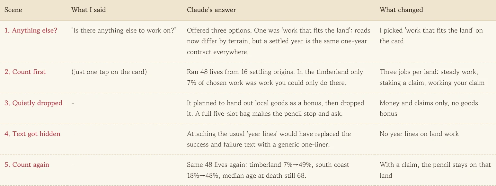
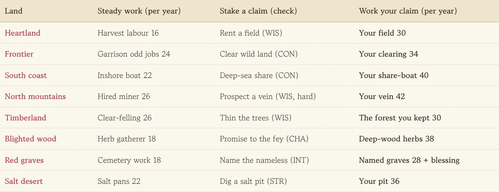
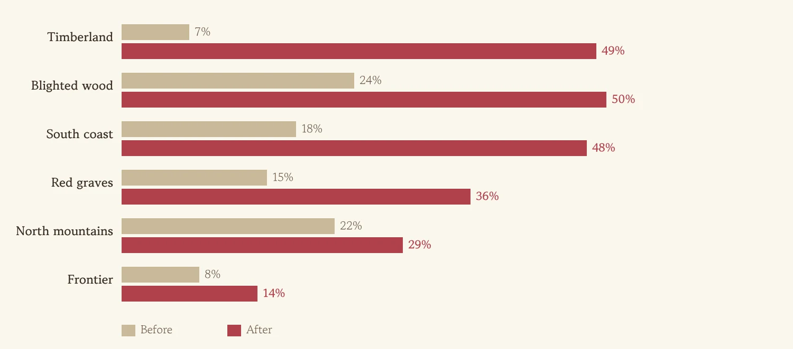
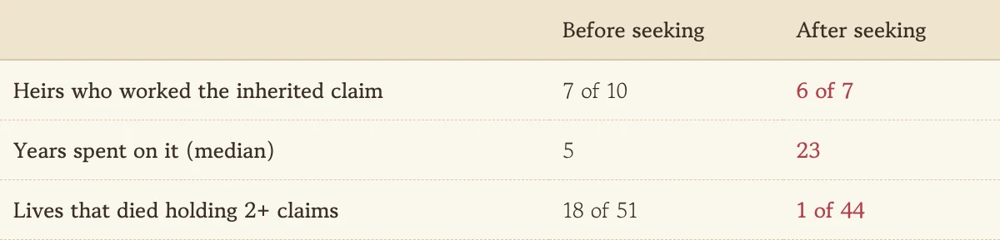

After boat-only roads and a desert you can only cross by caravan, travel finally felt different from land to land. Then, catching my breath, I noticed something odd. On the road everything was different, but the moment you settled in a village, a year in the timberland and a year on the coast both turned into the same "one-year contract job." This one starts with a throwaway question to Claude.

<figure><figcaption>I really only said the first line. Claude did the counting, the fixing and the counting again.</figcaption></figure>

## "Is there anything else to work on?"

Wrapping up the terrain work, I asked: "Is there anything else to work on?" Claude offered three options, and one of them was **"work that fits the land."** The pitch matched my nagging feeling exactly: wandering lives now changed with the land, but settled lives picked from the same menu everywhere. I tapped that card. That was the end of my part.

## Counting before fixing

Claude didn't start building. It counted first. It picked 16 origins that tend to stay put (miner clans, lumberjack families, dock porters and so on), let the pencil (autoplay) live 48 lives, and measured, land by land, what share of an adult's chosen work could only be done on that land.

The result was bleaker than I expected. Timberland 7%, frontier 8%, south coast 18%. Born into a lumberjack family, you still spent nine years out of ten on the same contract job as everyone else. The set was a logging camp, but the actors kept performing office scenes. **"It feels a bit flat" and "it's 7%" land very differently.**

## Three jobs per land, and a claim of your own

Claude's fix was three one-year jobs for each land.

1. **Steady work**: the local hired labour. Inshore boats on the coast, mine wages in the mountains, cemetery work in the graves. Pay and danger differ by land.
2. **Staking a claim**: a gamble with a check. Rent a field and farm it, sail the deep sea for a share of the catch, comb the mountain for a vein. Succeed and you have your own field, boat or vein; fail and you get hurt or scared.
3. **Working your claim**: only opens once you hold the claim. It pays best and, more importantly, **it gives you a reason not to leave.**

<figure><figcaption>Three jobs for each of eight lands, 24 in all. The mountain vein is the hardest to find and pays the most once you do.</figcaption></figure>

Each land got a little twist too. In the timberland, clear-felling pays more now, but only thinning the trees leaves you a claim. In the blighted wood, a promise to the fey lets you dig forbidden herbs, but failing spreads a bark curse. The red graves pay little, but giving names to nameless graves brings good deeds and a blessing. The pencil learned one more thing as well: settled adults try to stake a claim, and on land where they hold one they rarely leave, just like when they have family.

## One thing quietly dropped, one thing caught

The first plan also gave local goods as a bonus for steady work. Halfway through, it turned out the bag only has five slots, so a load of salt or timber every year would fill it fast and make the pencil stop and ask "drop this?" So the bonus went, and only money and claims stayed. Claude flagged this as a change from the plan on its own, which is how I found out.

The other catch was hidden text. When a one-year job ends, this game normally picks a "year line" saying what you did and how you got by. Attached to land work, that line would have replaced the carefully written success and failure text. The validator caught it, and land work now skips year lines.

## Living the same 48 lives again

After the fix, the same seeds lived the same 48 lives. 45 of them did land work and 39 held a claim.

<figure><figcaption>Grey is before, red is after. The north mountains barely moved because finding a vein is hard.</figcaption></figure>

Timberland went from 7% to 49%, the south coast from 18% to 48%. The north mountains only went from 22% to 29%: thirteen prospecting attempts led to just four years of working a vein. The mountain doesn't give up its secrets easily, and I left it that way. Median age at death stayed at 68, and median gold at death dipped from 266 to 237. I asked for lives that follow the land, not longer lives, so an unchanged lifespan is good news.

## Addendum: the claim goes to the kids

After posting this, I asked whether there was more to do on terrain, and Claude's first pick was this: a field, boat or vein you worked hard for simply vanished when you died. The whole game is about families carrying on across lives, yet the land wasn't carrying on at all. So now, like the family home and shop, a claim stays with the family if you die leaving children, and the next life born into that family inherits it. At birth you get a line like "You inherit the family's claim too: the thinned forest in The Stumpwood."

Running two generations back to back exposed a gap. A family settles where its first child was born, but the claim was often in a faraway land. Three of ten heirs never touched theirs, like inheriting a farm deed and staying in the city forever. So the pencil learned to **travel to a faraway claim**, and to stop grabbing new claims in other lands once it already holds one.

<figure><figcaption>Once heirs travel to it, the median time spent on the inherited claim goes from five years to twenty-three.</figcaption></figure>

## Three-line summary

1. Roads differed by land but settled life was the same contract everywhere, so each land got three jobs that only exist there.
2. Ask for a count before the fix. "7%" points the way much faster than "it feels flat."
3. Have the AI flag where it departed from the plan (like dropping the goods bonus), so you can tell what changed from the result alone.
