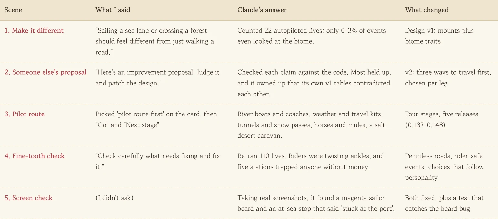
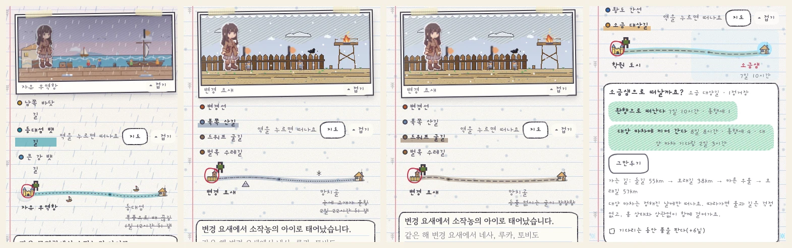
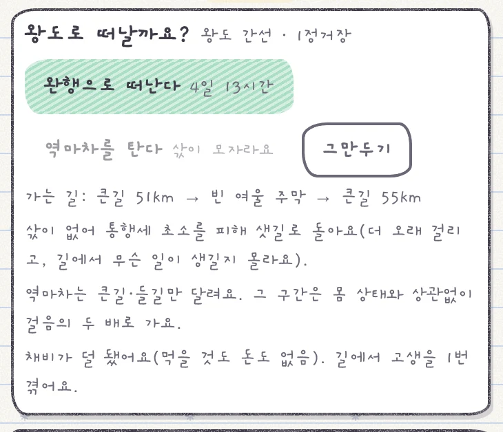
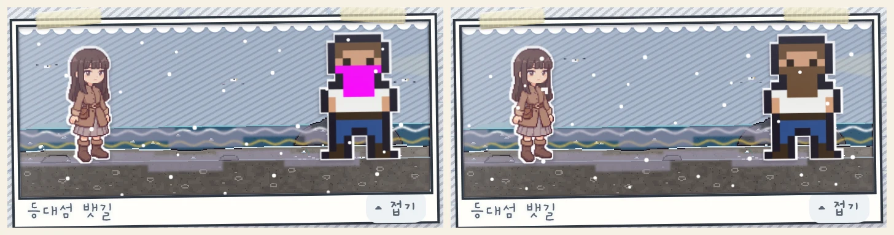

The world map in my notebook RPG boasts seven distinct terrains: coast, mountains, deep forest, a red graveyard belt, and more. Yet the moment you actually hit the road, sailing across open water and cutting through dense woods both collapsed into the same flat line: "you travel." Great map, identical commute. So I dropped one sentence in chat: "Sailing a sea lane or crossing a forest should feel different from just walking a road."

<figure><figcaption>Five back-and-forths, from one sentence asking for variety all the way to a visual check.</figcaption></figure>

## Seven biomes, zero difference

While I was at it, I asked a follow-up: the biomes exist in the data, sure, but do they actually change gameplay, and can a player even tell them apart?

Claude skipped the gut-feeling answer. It ran twenty-two lives through our autoplay bot ("the pencil") and tallied every event that fired. The verdict was awkward: **only 0–3% of events checked the biome at all.** Seven elaborate stage sets, one recycled script. Whether you grew up in the peaks or on the plains, life played out almost identically.

## Bringing in a second AI for a second opinion

Once Claude drafted the initial design, I pasted in a critique I'd gotten from another AI: "Here's an improvement proposal. Judge it and patch the design."

What impressed me was that Claude didn't blindly copy the suggestions in. It verified every claim against the actual codebase. Most held up, and Claude accepted them. On one point—"12 of 22 routes have no detour if blocked"—it pushed back with receipts: seven of those are natural dead ends like islands, so alternate paths were only needed in three places. Then it volunteered that its own first draft had a mount table and a terrain table contradicting each other. Like getting a second opinion from another doctor, **putting two AIs in the same room and forcing them to argue over code tightened the design in a single pass.**

## Splitting the roads in four stages

From there, my job was basically typing "Go" and "Next stage." After each stage, Claude built it, ran simulations, and came back with numbers.

1. Choose per leg: walk, ride the stagecoach, or board a boat. Boats and coaches run on fixed schedules.
2. Weather reshapes the journey. Summer storms sever sea lanes, and snow drags walking speed down. We also added a travel-kit card and hired guides.
3. Dwarf tunnels refuse entry without a light source, and winter mountain passes get snowed shut.
4. Buy, feed, and ride horses and mules. A brand-new salt desert can only be crossed by joining a caravan wagon.

<figure><figcaption>A storm-cut sea lane, a snowed-in pass, a pitch-black tunnel, and a salt desert you can only cross by caravan.</figcaption></figure>

## What "check it carefully" uncovered

With all four stages live, I added one last prompt: "Check carefully what needs fixing and fix it." Claude ran 110 simulated lives, and what popped out was equal parts hilarious and humbling.

1. **Riders were twisting their ankles on horseback.** Foot-travel mishaps were firing cheerfully for people riding horses and sitting inside stagecoaches. After the fix, all 47 twisted-ankle events happened strictly to travelers on foot.
2. 25 events had a single option picked over 85% of the time. Letting character traits nudge choices trimmed that list to 17. Most of the rest were common-sense picks—like a broke traveler accepting paid work—so I left them alone. Believable cause and effect beats artificially forcing a 50/50 split.
3. Five stations stranded anyone with zero coins. So we built penniless routes: sneak around toll posts on back paths, or work on deck to earn your passage. Broken leg and no coin for a cart? You limp along anyway.

<figure class="narrow"><figcaption>Flat broke, but still moving. It takes longer, and there are no guarantees about what waits on the back path.</figcaption></figure>

## What the simulation missed, the screenshots caught

After the numbers looked clean, Claude started snapping real screenshots for this post—and stumbled onto a gem. **The sailor had a blazing neon-magenta beard.** His beard color was missing from the palette, and the pirate and lighthouse keeper were rocking the exact same cyberpunk dye job. Around the same time we spotted an open-sea event calmly announcing, "You got stuck at the Free Port."

Over a hundred automated lives missed both. Simulations verify whether the rules make sense; screenshots verify whether what hits the eyeball makes sense. **They catch completely different classes of bugs.**

<figure><figcaption>Before on the left, after on the right—plus an automated test so neon beards don't sneak back in.</figcaption></figure>

Travel finally feels distinct from one region to the next. Next up: giving people who settle down in those lands jobs and stories that actually belong there.

## Three-line summary

1. Don't answer "can you feel the difference?" with vibes—run simulated play and count how often the system actually fires.
2. Never paste another AI's feedback blindly; make your main AI cross-check every claim against the codebase.
3. Simulations catch rule bugs and screenshots catch visual ones. Run both, or a neon-magenta beard will slip right past you.
