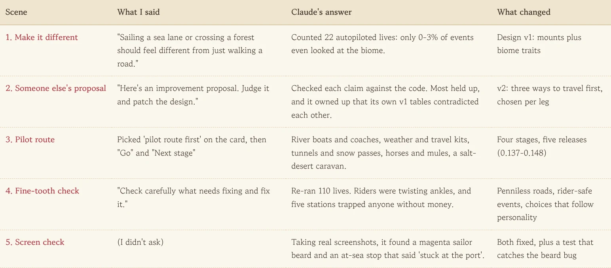
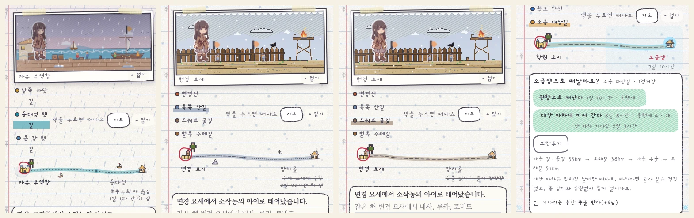
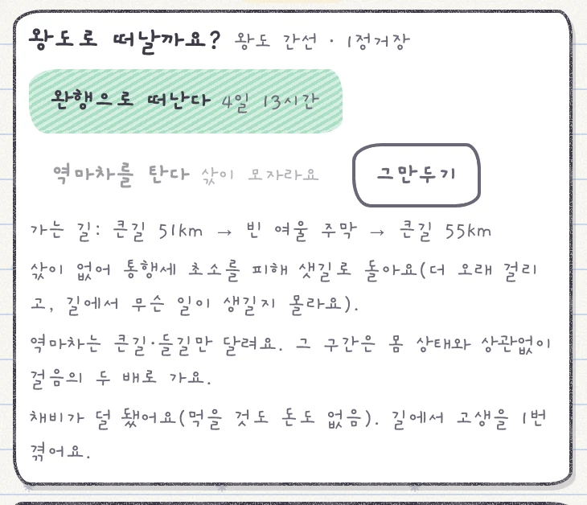
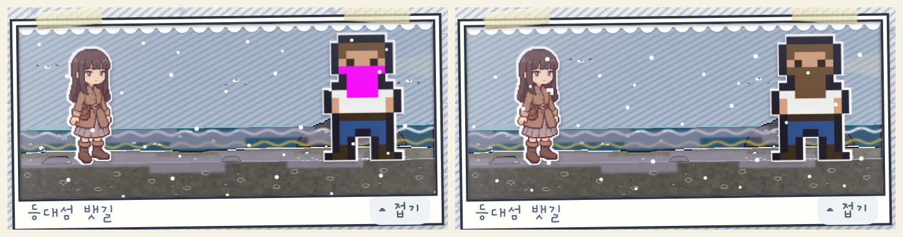

The world map in my notebook RPG has seven kinds of land: coast, mountains, forest, a red graveyard belt and more. But in play, sailing a sea lane and crossing a forest both boiled down to one line: "you travel." The map was fancy, the journeys were identical. So I wrote: "Sailing a sea lane or crossing a forest should feel different from just walking a road."

<figure><figcaption>Five rounds, from one line asking for a difference all the way to a screen check.</figcaption></figure>

## The biomes exist, but nobody can tell

While I was at it, I asked one more thing: the biomes are there, but do they actually affect the game, and is anything set up so players feel the difference? Claude didn't answer from gut feeling. It ran twenty-two lives on pencil mode (autoplay) and counted the events that actually fired. The result was embarrassing. **Only 0-3% of events even looked at the biome.** Seven stage sets, one script. Living in the mountains or on the plains, life played out almost exactly the same.

## Bringing in another AI's proposal

When Claude handed over its first design, I pasted in an improvement proposal I'd gotten from another AI: "Here's an improvement proposal. Judge it and patch the design." What I liked was that Claude didn't just copy it in. It checked each claim against the code, one by one, and agreed most of them held. It did add a footnote to "12 of 22 connections have no way around if cut": seven of those are naturally dead ends like islands, so alternate routes were only needed in three places. And it volunteered that its own first draft had a mount table and a terrain table that contradicted each other. Like getting a second opinion from another doctor, **pitting two AIs against each other on the evidence firmed the design up in one pass.**

## Splitting the roads in four stages

After that, all I really said was "Go" and "Next stage." Each stage, Claude built it, measured it and came back with the numbers.

1. You choose per leg: walk, take the coach, or take a boat. Boats and coaches only leave at set times.
2. Weather changes the road. Summer storms cut sea lanes, and snow slows you down. A travel kit card and hired guides arrived too.
3. Dwarf tunnels need a light to enter, and winter passes get snowed in.
4. You can buy, feed and ride horses and mules. The new salt desert can only be crossed by following a caravan wagon.

<figure><figcaption>A storm-cut sea lane, a snowed-in pass, a tunnel you can't enter without fire, and a salt desert you can only cross by wagon.</figcaption></figure>

## What "check it carefully" turned up

With all four stages live, I made one last request: "Check carefully what needs fixing and fix it." Claude re-ran 110 lives, and what came out was funny and a little painful.

1. **Riders were twisting their ankles.** Events meant for people on foot were also firing on horseback and in coaches. After the fix, all 47 ankle events happened to people walking.
2. 25 events had one choice picked more than 85% of the time. Letting personality pull toward different choices brought that down to 17. Most of the rest are things like a broke person taking a paid job, so I left them. Causes and consequences that make sense come before forcing a number.
3. Five stations trapped anyone with zero coins. So now there are penniless roads: you sneak around toll posts on back paths and pay for passage by working on deck. If your leg is broken and you can't pay for a cart, you limp.

<figure class="narrow"><figcaption>Broke, but there's still a way. It just takes longer, and who knows what happens on the way.</figcaption></figure>

## What the simulation missed, the screen caught

After the numbers check, Claude was taking real game screenshots for this post and caught one more thing: the sailor's beard was neon magenta. The beard color was missing from his palette, and the pirate and the lighthouse keeper had the same problem. It also caught a line that said "You got stuck at the Free Port" when an event happened in the middle of the sea. Over a hundred simulated lives saw neither. Numbers check whether the rules are right and the screen checks whether what you see is right, so **the two checks catch different bugs.**

<figure><figcaption>Before on the left, after on the right. There's now a test that catches the same mistake.</figcaption></figure>

Travel now feels quite different from land to land. Next I want to give people who stay put in a place more work and stories that belong to it.

## Three-line summary

1. Don't let "can you feel the difference?" be answered by gut feeling; have it counted with simulated play.
2. Don't paste in another AI's proposal as is; have its evidence checked against the code.
3. Numbers checks and screen checks catch different bugs, so ask for both.
