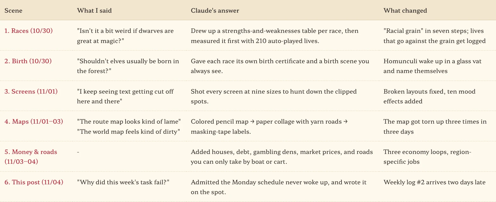
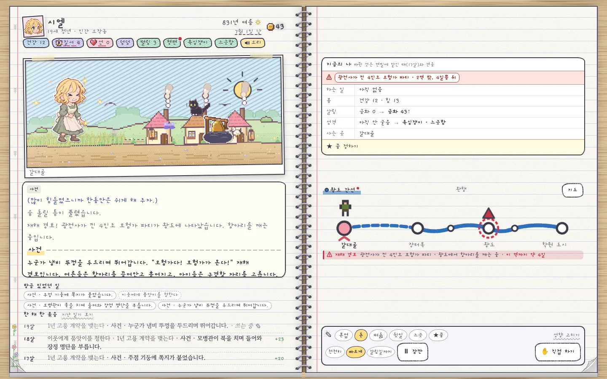
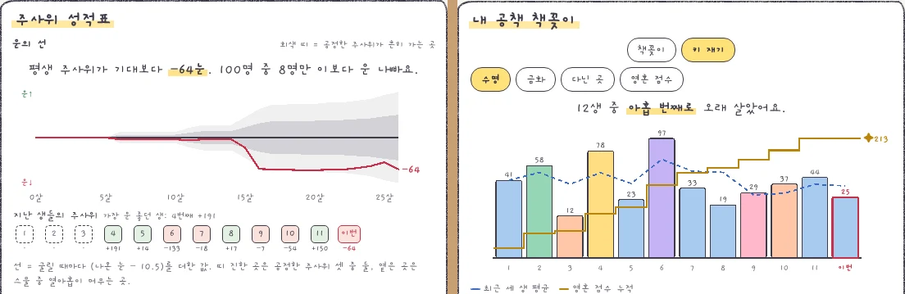
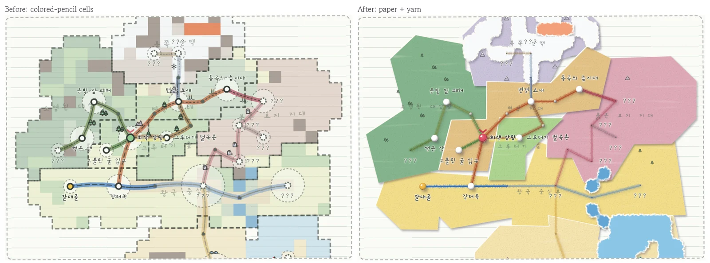
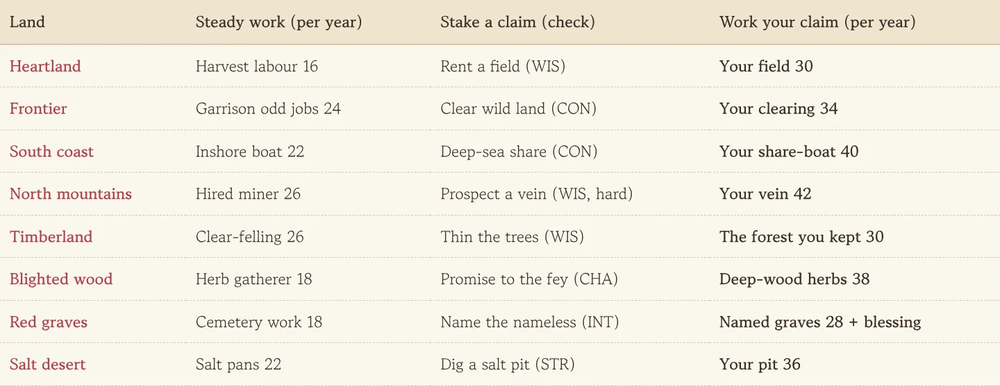
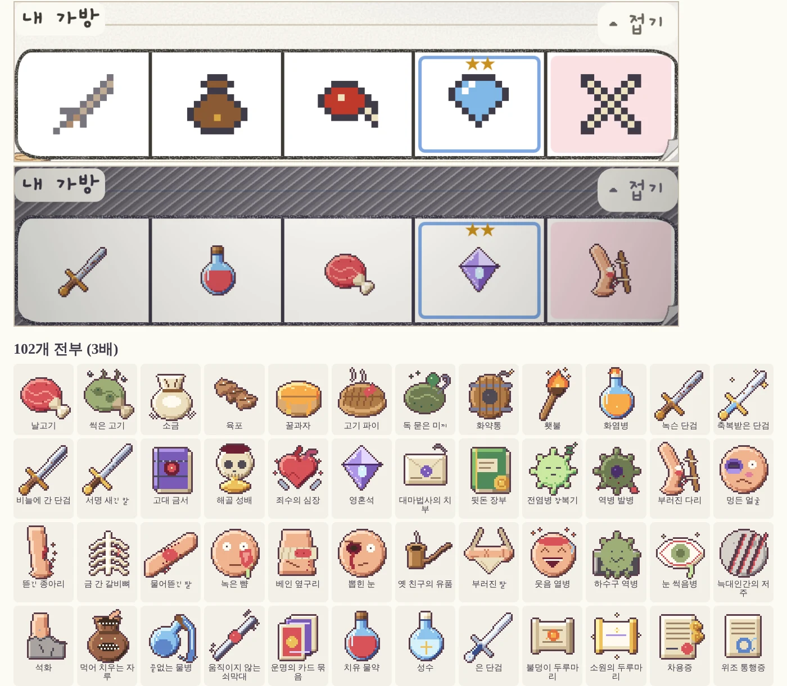

This post was supposed to appear on its own Monday evening. Last week I told Claude I wanted a schedule that posts the week's development to the blog every Monday at 5 p.m., and we set it up. By Wednesday there was still nothing, so I finally asked: "Why did this week's task fail?"

I'll save that story for the end. First, here's what happened inside the notebook last week. The game repository picked up 219 commits, and the game version climbed from 0.100.0 to 0.153.0.

<figure><figcaption>The week in six conversations. Half of them started with me grumbling one line.</figcaption></figure>

## Dwarves are bad at magic, elves are born in the forest

The big theme this week was **making who you're born as actually change your life**. One remark that it felt weird for dwarves to be great at magic turned into [racial grain](), and a comment that elves shouldn't be born just anywhere led to [birth scenes that differ by race](). After that came about three days of heavy construction, rebuilding how people live: origins, family shapes, family trades, how class is treated, gender customs. That's also when we found that a life could pass through 335 big wars while the notebook only mentioned 8, and [built a measuring tool before fixing it]().

## The fun of handing it to the pencil and watching

The game lets you hand your life to a pencil and watch it play out, though until now it was hard to tell at a glance what kind of life you were watching. This week, even from the spectator's seat, you can see what's happening and why the pencil made each choice in a single line. The pencil pauses when something touches your dream, and graphs now compare your life with others the same age. So this is what peeking at someone else's life feels like.

<figure><figcaption>The screen while the pencil is in charge. The "me right now" table at top right shows what changed since you handed it over.</figcaption></figure>

## The report card after death keeps getting thicker

The report card you get when a life ends gained new cards five times over. There's a bookshelf that measures you against past lives, a luck line showing how much worse your dice were than expected over a lifetime, a donut of causes of death, and a hall-of-fame chalkboard. The first time I read "your dice were −64 below expectation over your life," I felt oddly sorry for my character.

<figure><figcaption>Luck line on the left, height check against past lives on the right. Ninth-longest out of twelve: an awkwardly disappointing rank.</figcaption></figure>

## I tore up the map three times in three days

I asked for a screen check, blurted out that the route map looked kind of lame, and got a [colored pencil map](). Next I said the world map felt messy, so it became a [paper collage with yarn roads](), and finally [masking-tape labels and felt-pen lettering](). Getting mockups until I actually like one is the biggest luxury of working with AI, and this week I really felt it.

<figure><figcaption>Before and after the second of three rebuilds. The full story is split across the three map posts.</figcaption></figure>

## The notebook people now worry about money

Late in the week, life got a cost of living. A house you can buy and pass to your next life, debt and gambling dens, notice-board jobs, and shop and peddler prices arrived one after another, and skipping meals now brings hunger. When you die you can choose to leave your leftover gold to your soul, bury it, or give it to the neighborhood. Roads gained [routes you can only take by boat or cart](), and every land got [jobs that only exist there]().

<figure><figcaption>You cut forest in the timberland and work fishing boats on the southern sea. Where you live is now how you make a living.</figcaption></figure>

## Small things that took a lot of hands

The notebook made its first sounds with 26 sound and ambience effects, and all 102 card icons in the bag were redrawn as 32×32 pixel art. Someone else's effects code became [art for 13 spells](), and [fixing broken screens]() came with [a handful of mood effects](). Any player can now send an improvement note from inside the game with a suggestion button.

<figure><figcaption>Top is the old bag, bottom is this week's. The 9-pixel placeholders finally got promoted to real art.</figcaption></figure>

## The schedule that didn't show up for work

Back to the question at the top. Claude's answer was plain. Nothing failed halfway through writing; the alarm set for Monday at 16:48 simply never rang, and the schedule's log had no run at all. The alarm was set, but the phone was off. So I had it write this post on the spot, and it's now reworking the schedule so it wakes up reliably from next week.

**If you hand a recurring job to AI, check the first run with your own eyes.** You'd check that a new hire actually made it in on day one, too.

Next week I plan to finish filling in the art for people and monsters that appear in events. Here's hoping it shows up on Monday this time.

## Three-line summary

1. In week two, lives started to split by race and origin, the map got torn up three times, and notebook people got money worries.
2. Toss out one line of grumbling and AI answers with mockups and measurements, so don't sit on what bugs you.
3. Check the first result of anything you set to run on its own. The alarm might not ring.
