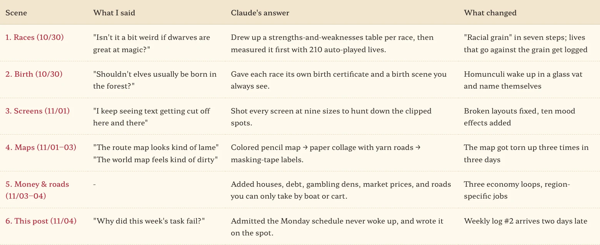
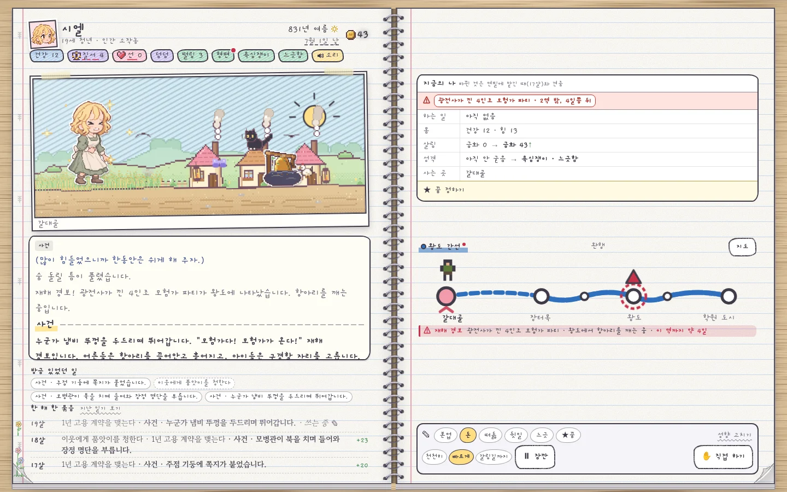
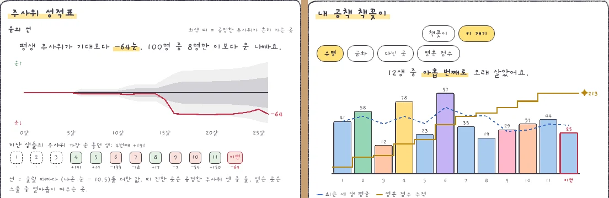
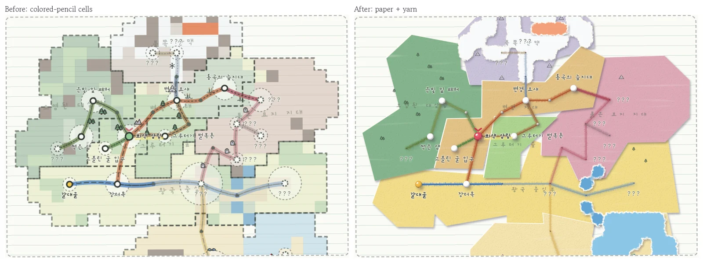
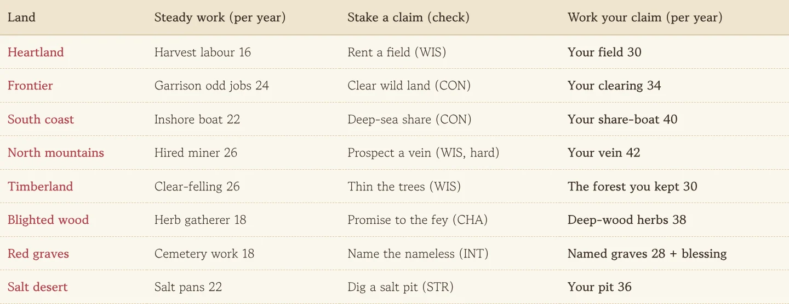
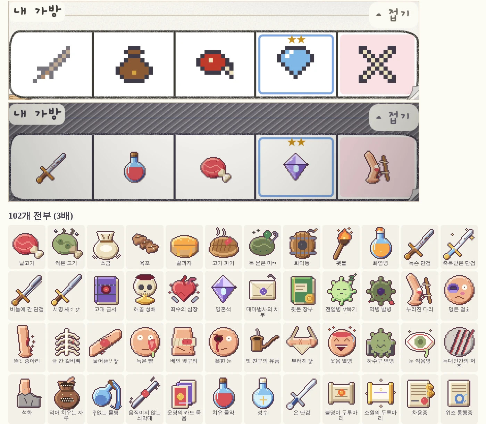

This post was supposed to publish itself on Monday evening. Last week I told Claude I wanted a recurring schedule that posts our weekly dev log every Monday at 5 p.m., and we wired it all up. By Wednesday the blog was still dead quiet, so I finally asked: "Why did this week's task fail?"

I'll save that confession for the end. First, here's what happened inside the notebook over the past week. The game repo racked up 219 commits, pushing the version from 0.100.0 to 0.153.0.

<figure><figcaption>The week boiled down to six conversations. Half of them started with a single line of grumbling from me.</figcaption></figure>

## Dwarves struggle with magic, elves are born in the forest

The big theme for week two was **making who you're born as actually shape your life**. One offhand comment that it felt strange for dwarves to sling magic effortlessly turned into [racial grain](), and saying elves shouldn't be born in random towns led to [birth scenes that differ by race]().

That kicked off roughly three days of heavy remodeling across origins, family structures, family trades, class treatment, and gender customs. Along the way, we caught a bizarre bug where characters lived through 335 major wars while the notebook only bothered mentioning 8—and [built a measuring tool before fixing it]().

## Handing the reins to the pencil and watching

The game has an auto-play mode where you hand your life over to a "pencil" and watch it unfold. Until now, though, watching from the sidelines felt blurry—it was hard to tell what kind of life was actually happening.

This week, even in spectator mode, you get a one-line readout of what's going on and why the pencil chose each move. When an event brushes against your character's dream, the pencil pauses to let you step in, and graphs now compare your life with peers of the same age. Sitting back and eavesdropping on a stranger's life turned out to be oddly captivating.

<figure><figcaption>Watching while the pencil drives. The "me right now" box at top right tracks what shifted since you handed over control.</figcaption></figure>

## The post-death report card keeps getting thicker

The end-of-life report card grew across five separate updates. We added a bookshelf that stacks your lifespan against past lives, a luck line charting how far your dice fell below expectation, a donut chart of causes of death, and a hall-of-fame chalkboard. The first time I saw *"Your dice rolled −64 below expectation over your lifetime,"* I genuinely felt bad for my little character.

<figure><figcaption>Luck line on the left, lifespan lineup on the right. Ninth longest out of twelve—an awkwardly underwhelming ranking.</figcaption></figure>

## Tearing up the map three times in three days

During a routine screen check, I blurted out that the route map looked pretty drab, and out came a [colored pencil map](). Next I complained the world map looked cluttered, so it became a [paper collage with yarn roads](), before finally landing on [masking-tape labels and felt-pen lettering](). Asking for mockup after mockup until something clicks is easily the biggest luxury of working with AI, and this week I indulged.

<figure><figcaption>Before and after the second of three overhauls. The full saga lives across the three map posts.</figcaption></figure>

## The notebook folks now have bills to pay

Late in the week, a cost of living arrived. You can now buy a house and pass it down to your next life—and right alongside it came debt, gambling dens, notice-board gigs, and fluctuating shop and peddler prices. Skip meals, and hunger catches up. On your deathbed, you decide whether your leftover gold goes to your soul, gets buried in the ground, or stays with the neighborhood.

Travel also split into [routes accessible only by boat or cart](), and every region gained [jobs unique to that land](). Where you live now dictates how you earn your bread.

<figure><figcaption>You fell trees in the timberland and crew fishing boats on the southern sea. Geography is now a career choice.</figcaption></figure>

## Quiet touches that still took plenty of work

The notebook found its voice this week with 26 sound and ambient effects, and all 102 bag card icons were redrawn as 32×32 pixel art. Borrowing open effects code gave us [animations for 13 spells](), while [patching broken screens]() brought along [a batch of mood effects](). I also slipped in an in-game suggestion button so players can send feedback straight from the notebook.

<figure><figcaption>Old bag on top, this week's below. The tiny 9-pixel placeholders finally earned a promotion to real art.</figcaption></figure>

## About that schedule that never showed up

Back to the mystery at the top. Claude's explanation was refreshingly blunt: nothing crashed halfway through writing. The alarm set for Monday at 16:48 simply never fired, and the schedule log showed zero runs. It was the digital equivalent of setting an alarm on a phone that's turned off. So I had Claude write this post on the spot, and we're reworking the trigger so it actually wakes up next week.

**Whenever you hand a recurring task to AI, check the very first run yourself.** You'd check that a new hire made it into the office on day one, too.

Next week I plan to finish filling out the character and monster portraits for events. Fingers crossed the Monday alarm makes it in on time.

## Three-line summary

1. Week two made race and origin genuinely alter a life, rebuilt the map three times, and introduced notebook residents to the joys of paying bills.
2. One line of grumbling is enough to get mockups and measurements back from AI—don't sit on things that bug you.
3. Always verify the first run of an automated job. Sometimes the alarm never rings at all.
