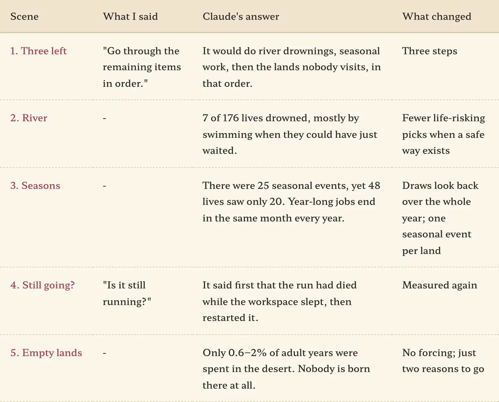
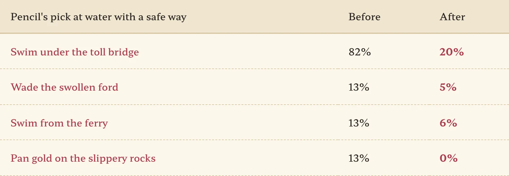
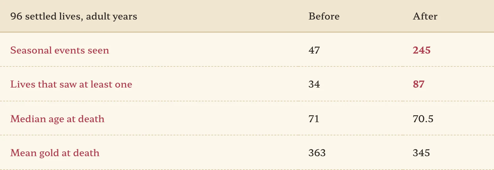
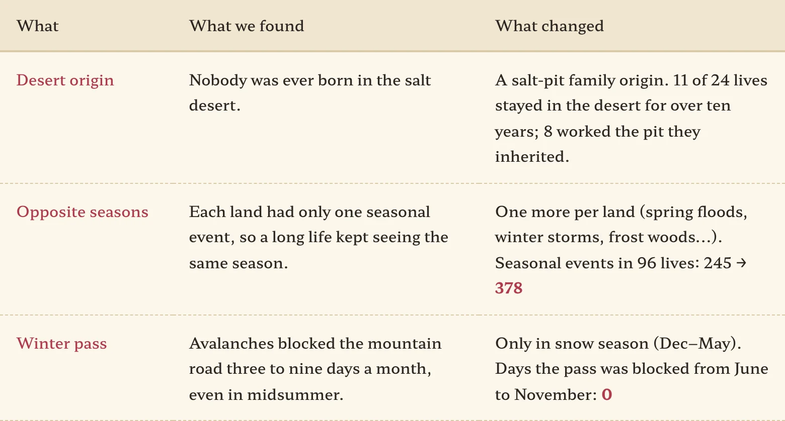

Once every region had its own jobs and heirs could inherit family claims, Claude still had three leftovers jotted on its notepad. Why were so many characters drowning in rivers? Why did every year feel identical despite having four seasons? And why did nobody ever set foot in the salt desert or the northern peaks? Once again, I sent a single sentence.

<figure><figcaption>My whole contribution was two lines—and one of them was just "Is it still running?"</figcaption></figure>

## "Go through the remaining items in order"

Claude lined them up: rivers first, seasons second, empty lands last. For every single one, it ran a baseline count before touching the code, then re-ran the exact same random seeds afterward. I don't even have to ask for that discipline anymore—it's become muscle memory.

## Why swim when you could just wait?

Running 176 lives through our autoplay bot ("the pencil"), 7 characters drowned. Pulling their death logs turned up an absurd pattern. At a flooded ford, "wait for the water to drop" sat right there for free. At the toll bridge, "slip across at dusk" was free too. Yet the pencil kept throwing itself into raging water just to save half a day. At the toll bridge, eight out of ten jumped in—that wasn't heroism, that was terrible math.

So we taught the pencil one rule of common sense: **when there's a safe option with no dice roll and no harm, stop casually picking the lethal one.** Reckless personalities still get to dive in, though. For them it's character, not a bug.

<figure><figcaption>We stood the same 96 adults at each riverbank and tallied their choices. Most of the remaining 20% are genuinely reckless.</figcaption></figure>

A nice side effect tagged along: deaths from picking fights with owlbears dropped from 9 to 4. When climbing a tree is right there, characters finally stop trying to box a monster.

## Twenty-five seasonal events, stuck in eternal March

The second leftover had an even funnier root cause. The game already packed 25 seasonal events—airing quilts in spring, putting up stores in autumn, splitting firewood in winter. Yet across 48 settled lives, all their adult years combined saw just 20 of them.

Claude traced the bug straight to the calendar. Adult events only draw when a job wraps up, and a year-long job finishes in the exact same month every single year. So every time the game asked "what month is it?" to pick an event, it got the exact same answer. If your contracts always ended in March, autumn literally never arrived in your lifetime. The fix was dead simple: when a job ends, check every month the character lived through during that job. For a year-long job, that's all twelve months.

On top of that, we added a signature seasonal event for each land: autumn harvest in the heartland, spring herring off the south coast, snowed-in winters up north, caravan season in the desert. If you hold a stake in that land, custom options like "chase the shoal in your own boat" unlock too.

<figure><figcaption>87 out of 96 settled lives now experience the seasons turning at least once.</figcaption></figure>

Midway through, median gold at death plunged from 204 to 122 coins, and my stomach dropped. Before I panicked, Claude resampled the run several times and confirmed the drop was indistinguishable from random noise—the means barely moved, 363 versus 345. Lesson learned: when a metric jumps, ask **"is that a real difference?"** before diving back into the code.

## Let the desert stay empty, just unlock the door

Last came the ghost towns. Across 88 lives drawn evenly from every origin, characters spent just 0.6–2% of their adult years in the salt desert. No mystery there: nobody was born in the desert, the road was a dead end, and the terrain was brutal. Of course people stayed home.

Instead of artificially herding NPCs into the sand, Claude suggested simply opening a reason to go. Before caravan season, salt merchants hire hands at the capital's market; before winter hits, a dwarf clan recruits miners for the cold season. Sign on, and you end up there. Re-measuring showed total time spent barely budged—wanderers take the bait while settled folks stay put—but at least the door is open now.

## Addendum: desert natives, and an avalanche in July

After publishing the draft, I asked one more time if anything remained on the terrain list. Claude came back with three items, and I replied, "Go through them in order."

First: a desert origin. Even with recruitment events, the desert stayed quiet because nobody ever started life there. So we added a "salt-pit family." You grow up at the oasis hauling well buckets and watering camels until your father hands you a salt pit of your own—stay to work it, or strike out for the city. Second, we added an opposite-season event for every land. Third, while auditing the winter pass, we tripped over a classic: **avalanches were blocking the mountain road in midsummer.** An avalanche in July makes zero sense, so now they stick strictly to snow season.

<figure><figcaption>Roughly half of the 24 desert-born lives still take to the road—peddling runs in the family, after all.</figcaption></figure>

## Three-line summary

1. The autoplay bot kept swimming deadly rivers to save half a day; teaching it to favor safe paths cut bridge swimming from 82% to 20%.
2. Seasonal events barely fired because year-long jobs always ended in the same month. Checking all twelve months took seasonal events across 96 lives from 47 to 245.
3. When a simulation number drops sharply, ask "is that real or noise?" first. What looked like gold getting cut in half turned out to be sampling luck.
