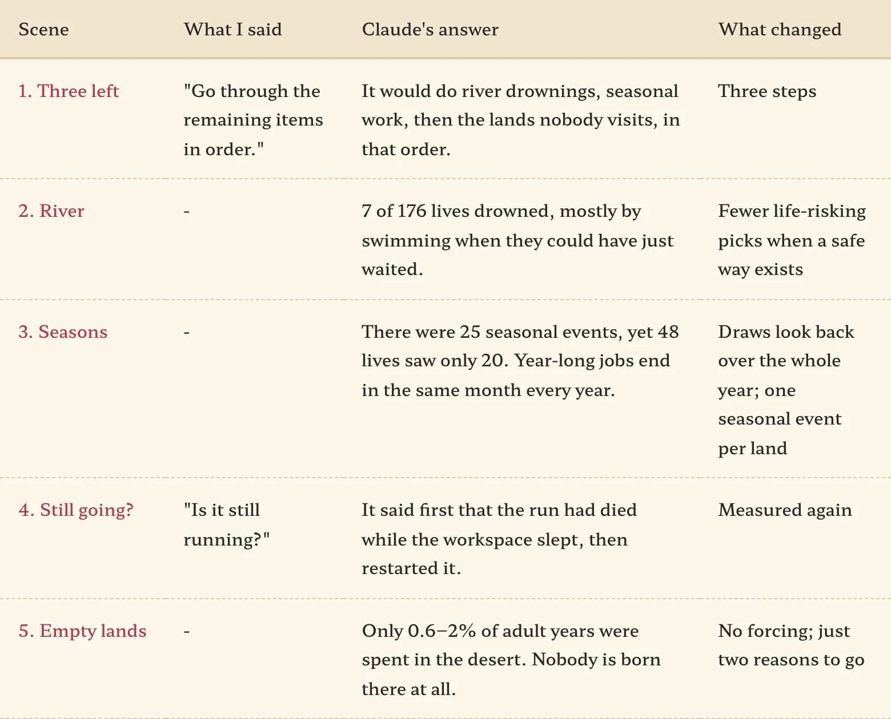
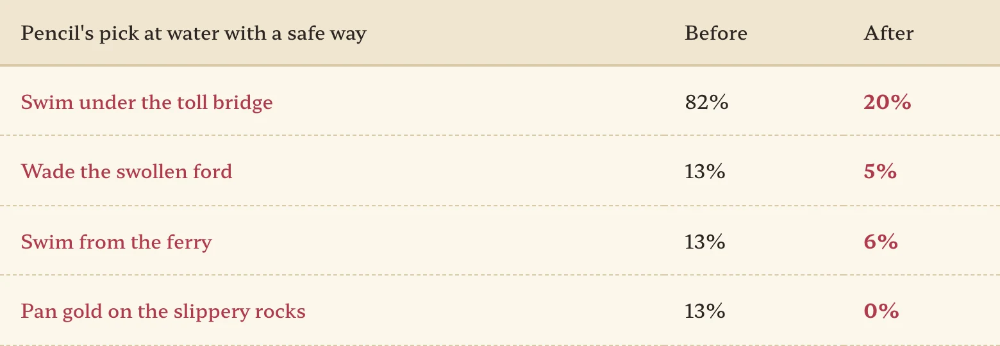
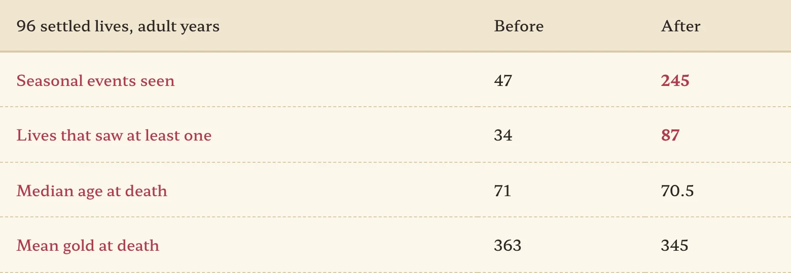
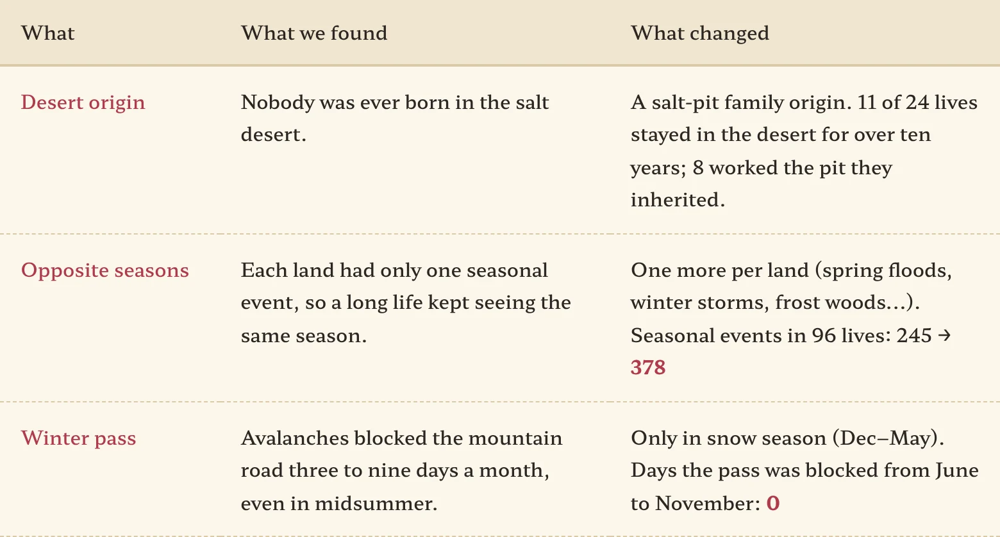

After adding land-specific jobs and letting children inherit their parents' stakes, Claude had three leftovers noted down. Why do so many people drown in rivers? Why does every year feel the same no matter the season? And why does nobody go to the salt desert or the northern mountains? I sent exactly one line.

<figure><figcaption>My part was two lines again. One of them was "Is it still running?"</figcaption></figure>

## "Go through the remaining items in order"

Claude set the order first: rivers, seasons, then the empty lands. For all three it counted before fixing anything, then counted again with the same seeds afterward. I no longer have to ask for that order; it just happens.

## Why swim when you could wait?

Running 176 lives on autopilot ("hand it to the pencil"), 7 drowned. Looking at each one, they had something in common. At a swollen ford, "wait for the water to drop" was right there for free. At the toll bridge, "slip across at dusk" was free too. The pencil was jumping into the water to save half a day. At the bridge, eight out of ten swam. That isn't courage, it's bad math.

So we taught the pencil one rule. **If there's a way through with no roll and no harm, pick the life-risking option that much less.** Reckless personalities still get to jump in, though. For them it isn't a mistake, it's who they are.

<figure><figcaption>We stood the same 96 adults at each riverbank and counted their picks. Most of the remaining 20% are reckless types.</figcaption></figure>

As a bonus, deaths from fighting an owlbear fell from 9 to 4. When climbing a tree is an option, they no longer pick the fight.

## The seasonal events existed, but the seasons never came

The second leftover was more fun. The game already had 25 seasonal events: airing quilts in spring, putting up stores in autumn, splitting firewood in winter. Yet across 48 settled lives, all their adult years together saw only 20 of them.

Claude found the cause in the calendar. Adult events are drawn when a job ends, and a year-long job ends in the same month every year. So whenever the game asked "what month is it?" while drawing, the answer was always the same. For someone whose jobs always ended in March, autumn never arrived. The fix is simple: when a job ends, the draw looks at every month that job passed through. For a year-long job, that's the whole year.

On top of that we added one seasonal event per land. Harvest in the heartland, spring herring off the south coast, snowed-in winters in the northern mountains, caravan season in the desert. If you hold a stake in that land, options like "chase the shoal in your own boat" open up.

<figure><figcaption>87 of the 96 lives now see the seasons turn at least once.</figcaption></figure>

Partway through, median gold at death dropped from 204 to 122 coins and my heart sank. Claude resampled the same lives many times and said it couldn't be told apart from chance. The means are nearly the same, 363 and 345. What I learned: before rushing to fix a number that jumped, ask "is that a real difference?"

## Let the desert be a desert

Last were the lands nobody visits. Across 88 lives drawn evenly from all origins, only 0.6–2% of adult years were spent in the salt desert. The reason was simple. Nobody is born there, the road is a dead end, and the land is harsh. Of course people don't go.

Here Claude suggested not forcing a crowd. Instead it opened one reason to go for each. Before caravan season, a salt caravan hires hands at the capital's market. Before the snow, a dwarf clan gathers workers for the winter mine. Follow them and you end up there. Measured again, the share of time spent there barely moved. Wanderers follow; settled folks mostly don't. But the door is open now.

## Addendum: people born in the desert

After posting, I asked again whether anything was left on the terrain side. Claude named three things, and all I said was "Go through them in order."

First, a desert origin. Even with the doors open, the real reason the desert was empty was that nobody was ever born there. So we made a "salt-pit family." You're born at the oasis, grow up pulling the well bucket and watering camels, and as a young adult your father gives you one of the pits. You can take it, or head off to the city. Second, one more seasonal event per land. Third, while measuring the winter pass, we found something odd: avalanches were blocking the mountain road in midsummer. An avalanche in July doesn't make causal sense, so now they only happen in snow season.

<figure><figcaption>About half of the 24 desert-born lives still take to the road. The family trade is peddling, after all.</figcaption></figure>

## Three-line summary

1. The pencil was swimming rivers it could have waited out. Making it pick fewer life-risking options when a safe way exists cut swimming under the bridge from 82% to 20%.
2. Seasonal events didn't show up because year-long jobs always ended in the same month. Looking back over the whole year took seasonal events in 96 lives from 47 to 245.
3. When a number jumps, ask "is that a real difference?" first. I thought gold had been cut in half; it was within chance.
