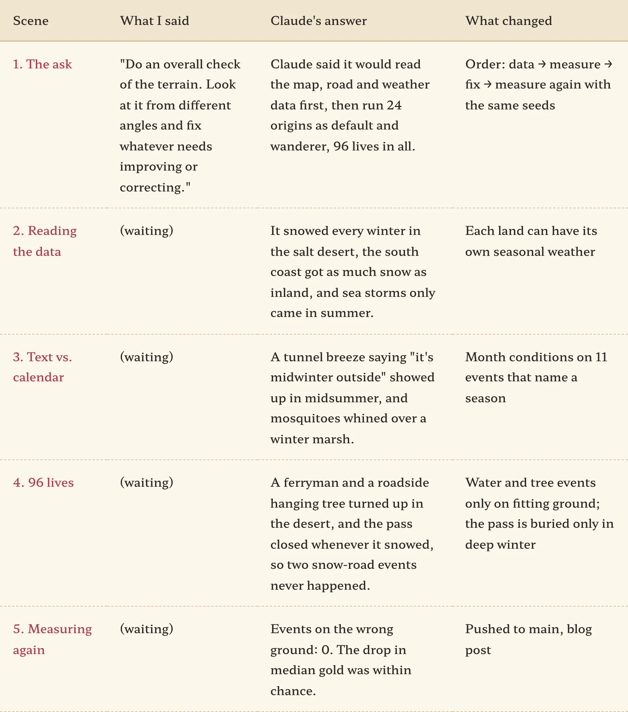
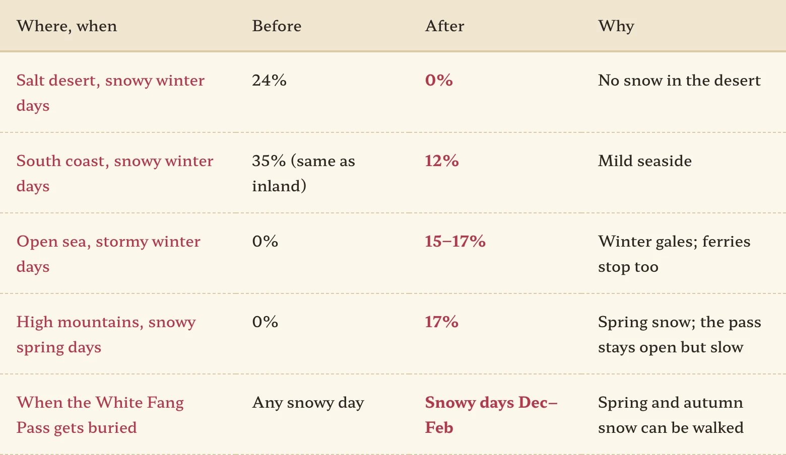
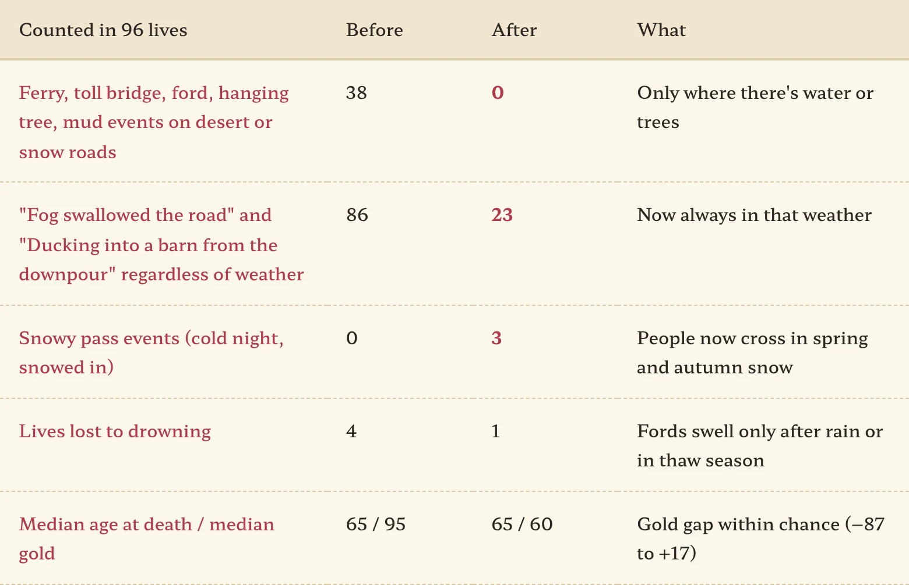

We had added jobs for each land, seasonal events, even a desert-born origin. At that point, instead of fixing things one by one, it felt like time to sweep the whole terrain. Once again, all I sent was one line.

<figure><figcaption>My part was the first line. The rest was waiting.</figcaption></figure>

## "Look at it from different angles and fix it"

The exact words were "Do an overall check of the terrain. Look at it from different angles and fix whatever needs improving or correcting." Claude set the order first: read the map, road and weather data by eye, then run all 24 origins as a default life and a wanderer, 96 lives in all. **Find what looks odd in the data, then check whether it actually blows up in real lives.** A two-layer check.

## Snowdrifts in the salt desert

The first catch from the data was the weather. Weather comes from seasonal odds multiplied by a per-land factor, and the salt desert was missing the factor that says "no snow here." So 24% of its winter days were snowy. Picture camels under palm trees in a blizzard. The south coast got snow on 35% of winter days, same as inland, while sea storms only ever came in summer. And I had just added a "winter storm season" event for the coast, while the actual sky stayed clear and the boats kept sailing.

You can't create weather that isn't there by multiplying, so Claude added a new field that **adds** seasonal weather per land. The sea now gets storms in winter, and the high mountains get snow in spring and late autumn.

<figure><figcaption>When a winter storm hits the sea now, the lighthouse ferry stays tied up.</figcaption></figure>

## The text says midwinter, the calendar says July

Second came events whose text and calendar disagreed. A dwarf-tunnel breeze that says "it's midwinter outside but spring in here" showed up in midsummer, and mosquitoes whined over a winter marsh. The farmer hiring harvest hands on the road was holding a sickle in February. Eleven events named a season but could happen in any month. Each one now has a month condition.

## Taking a ferry across the desert

The real fun came after running the 96 lives. Counting road events by terrain, there was a ferryman on the desert sand demanding extra fare "in the middle of the river." On sand without a single tree, an old roadside tree stood with three ropes hanging from it. Events that only make sense near water or trees happened on the wrong ground 38 times. "Fog swallowed the road" also showed up on bright clear days.

One more. The White Fang Pass closed whenever it snowed, yet the "cold night in the snow" and "snowed in at the pass" events only happen on a snowy pass. Since nobody could get through in snow, those two never happened once in 96 lives. We'd locked the door and then waited for something to happen inside the room. So now **the pass is buried only by deep-winter snow (December to February), and in spring or autumn snow it stays open but slow.**

<figure><figcaption>Same seeds, run again. No more desert ferries.</figcaption></figure>

This time I flinched less when median gold dropped from 95 to 60 coins. Like last time, I asked "is that a real difference?" first, and Claude resampled and said it was within chance.

## Three-line summary

1. We tuned the weather per land. Winter snow in the salt desert went from 24% to 0%, and the sea now gets storms in winter.
2. Events whose text names a season, water or trees now happen only in that season and on that ground. Events on the wrong ground went from 38 to 0.
3. When you hand off a check, ask for two layers: read the data, then actually run it and count. The desert ferry never showed up in the data alone.
