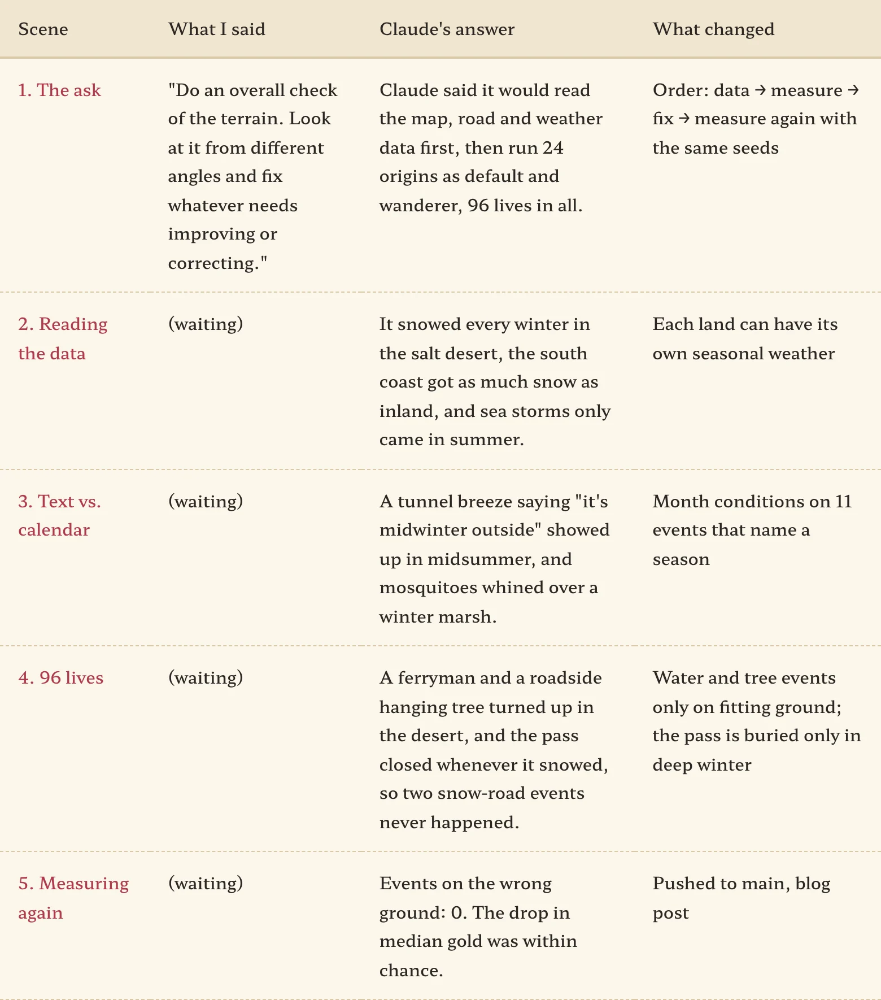
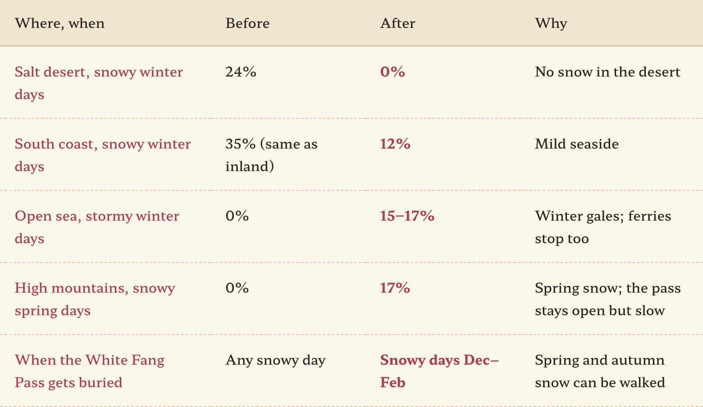
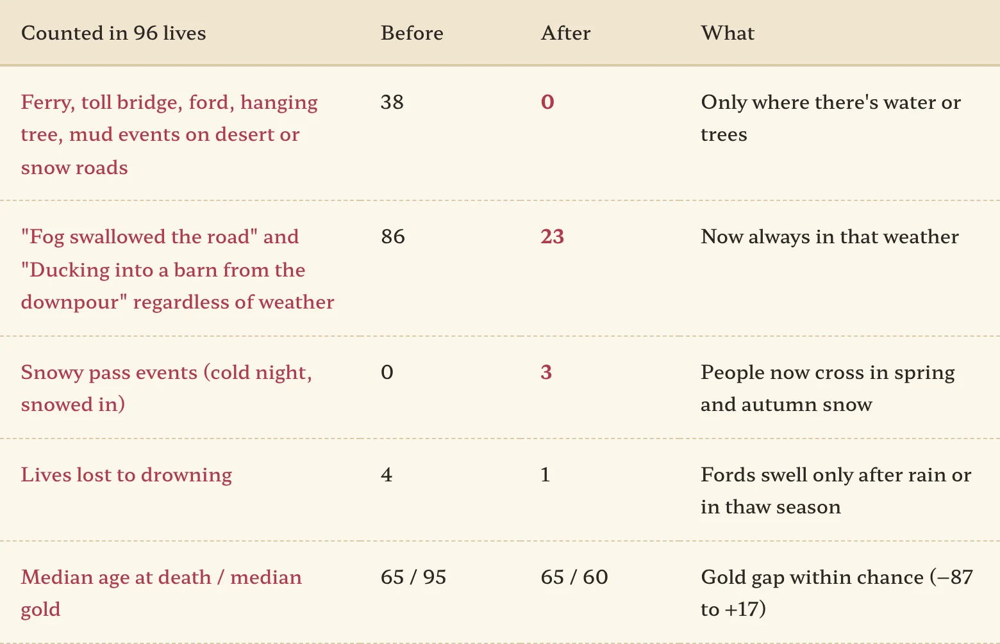

We had built regional jobs, seasonal events, and even a desert-born origin. Rather than patching one corner at a time, it felt overdue to sweep the entire world map in one go. Once again, I dropped a single sentence into chat.

<figure><figcaption>My job was the first sentence. The rest was waiting with a cup of coffee.</figcaption></figure>

## "Look at it from different angles and fix it"

My exact prompt was: "Do an overall check of the terrain. Look at it from different angles and fix whatever needs improving or correcting."

Claude split the audit into two layers. First, read through the map, road, and weather tables by eye. Second, run all 24 origins as both a settled life and a wanderer—96 simulated lives on autoplay. **Spot the suspicious holes in the data, then watch whether they actually blow up in live play.**

## Blizzards over the palm trees

The data pass caught weather first. Our weather engine multiplies base seasonal odds by a per-region factor, and the salt desert was missing the entry that says "zero snow." As a result, 24% of desert winter days were snowy—camels trudging under palm trees in a winter wonderland.

The south coast was just as confused. It got snow on 35% of winter days (same as inland), while sea storms only ever struck in summer. Meanwhile I had just added a "winter storm season" event for coastal life, while the actual skies stayed sunny and boats sailed right on schedule.

Since multiplying zero by anything still gives you zero, Claude added an **additive** seasonal weather field per region. Now the sea actually sees storms on 15–17% of winter days, and high mountains catch snow in spring and late autumn too.

<figure><figcaption>When a winter storm rolls in now, the lighthouse ferry actually stays tied to the dock.</figcaption></figure>

## The text says midwinter, the calendar says July

Next came events whose prose and calendar flatly contradicted each other. A dwarf-tunnel draft murmuring "it's midwinter outside, yet spring in here" blew happily in July. Swarms of mosquitoes whined over a frozen winter marsh. And a roadside farmer hiring harvest hands stood waving a sickle in February. Eleven events named a specific season in their text while firing in any month of the year. Every single one got a month lock.

## Taking a ferry across dry sand

The real comedy waited inside the 96 simulated lives. Grouping road events by terrain revealed a ferryman out on the salt desert demanding extra fare **"in the middle of the river."** On treeless open sand, an ancient roadside oak stood with three ropes dangling from its branches. Water and woodland events fired on impossible terrain 38 times, while "fog swallowed the road" rolled in cheerfully under bright blue skies.

There was also a neat logical trap. The White Fang Pass closed whenever it snowed—yet the "freezing night in the snow" and "trapped at the pass" events could only trigger on a snowy pass. Because snow sealed the road, nobody ever entered, and both events fired exactly zero times in 96 lives. We'd locked the door from the outside and waited for drama to happen inside the room. Now **the pass only closes during deep-winter snow (December to February); in spring or autumn snow it stays open, just slower.**

<figure><figcaption>Re-run with the exact same random seeds. The desert ferryman has officially been retired.</figcaption></figure>

When median gold slid from 95 to 60 coins, I barely blinked this time. Taking my own advice from the previous post, I asked "is that a real difference?" first—and Claude resampled and confirmed it sat squarely within random noise.

## Three-line summary

1. Tuning per-region weather wiped winter snow in the salt desert from 24% down to 0% and gave the winter sea real storms.
2. Locking seasonal, water, and tree events to matching months and lands dropped absurd terrain mismatches from 38 to 0.
3. For any serious audit, ask your AI for two layers: inspect the static data, then run simulations and count. The desert ferryman would never have turned up by reading tables alone.
