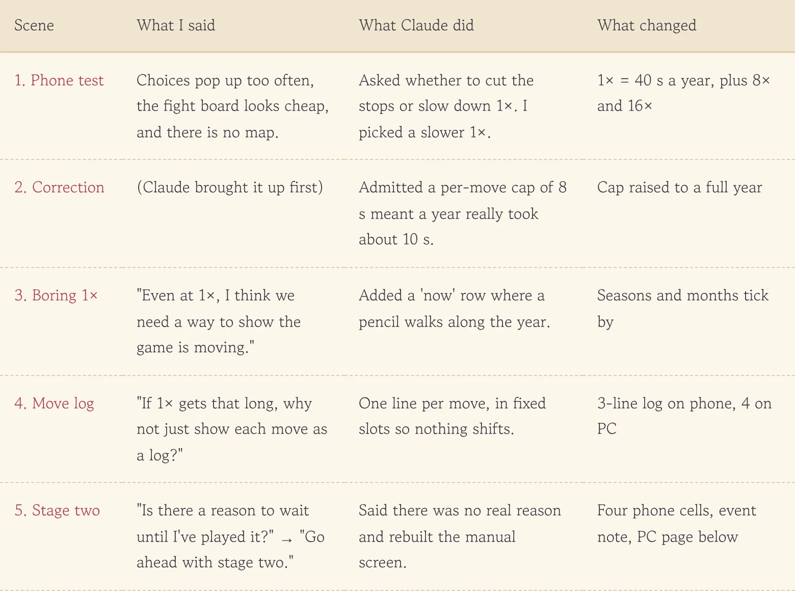
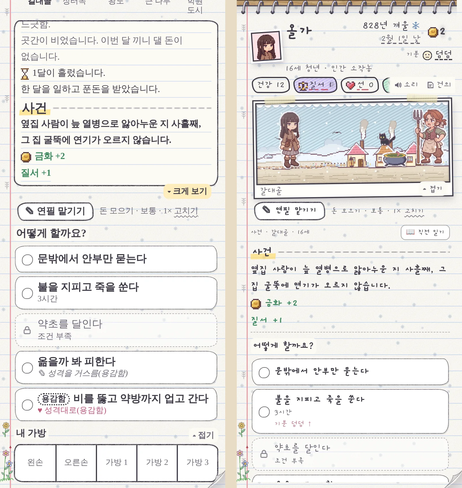
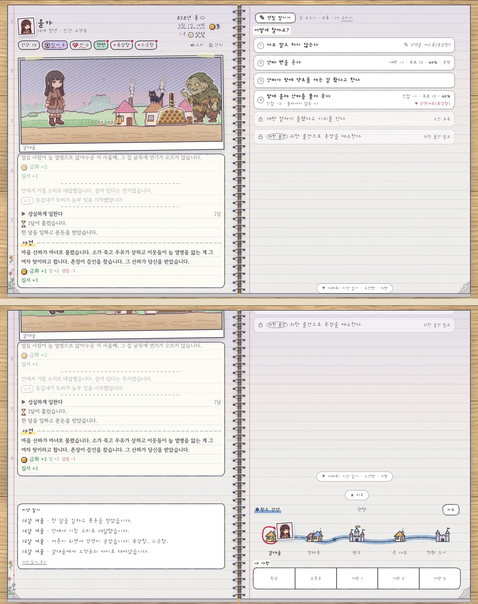
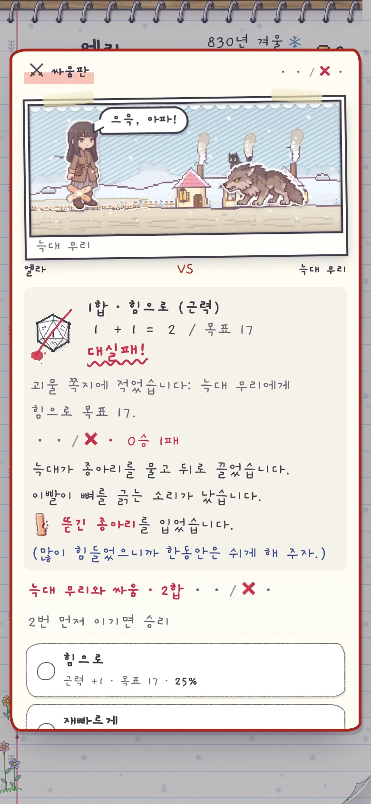

That morning we had shipped the shiny new autoplay sketchbook, so I opened it on my phone and let it run for a while. On a desktop monitor it looked polished. In the palm of my hand, it fell apart. Choice notes popped up nonstop, the combat board felt flimsy, and the map from the morning's spec was nowhere to be seen. I bundled all my complaints into one big message and tossed it over to Claude.

<figure><figcaption>One morning rant ended up rebuilding the entire hands-on screen by evening.</figcaption></figure>

## Cut the pauses, or slow the clock?

When I complained that choice notes popped up too often, Claude didn't lunge for the editor. It laid out two options: cut the number of pauses, or slow 1× down so pauses feel naturally spaced out. It even ran the math on *1 in 8 Billion*—a game we've been taking inspiration from—and pointed out that its 16× speed was roughly our old 1×. I kept the pauses and slowed the clock. Now a year takes 40 seconds at 1×, with new 8× and 16× speeds for anyone in a hurry.

A few minutes later, Claude came back with an unprompted confession. A hidden 8-second cap per action meant a year-long job was actually wrapping up in roughly 10 seconds. **Hearing "that 40 seconds I promised was wrong" before I even caught it made me trust its numbers more, not less.** Raising the cap to a full year made 40 seconds genuinely 40 seconds.

## Slow enough to look frozen

Slowing 1× down immediately created a fresh problem: the screen sat so still I couldn't tell if the game was running or crashed. "Even at 1×, we need a way to show the game is moving," I said. Under the summary board, a year-long progress bar appeared with a tiny pencil steadily strolling across it as seasons and months ticked past.

Watching it stroll gave me another thought: "If 1× takes this long, why not show each move as a small log?" Now every action the pencil takes adds a line to a compact feed. Because we locked the container height upfront, new lines never shove the layout around—keeping the layout-shift score glued near 0.001.

## Wait—why are we waiting?

Originally, stage two (rebuilding the manual hands-on screen) was supposed to wait until I'd played with the sketchbook for a few days. Then curiosity got the better of me: "Is there any actual reason to wait until I've played it before doing part two?" Claude's answer was refreshingly short: no technical reason, it was just the order written in the plan. My reply was even shorter: "Go ahead with stage two."

First on the operating table was the mobile event screen. Before, once you finished reading an event's prose, the actual choices sat miles below the fold, forcing a long thumb scroll every time. **Now the phone layout locks into four fixed cells—profile, scene, diary, and choices—and when an event hits, the diary folds away so the choice cell becomes the event note.** Event prose and buttons fit cleanly in one viewport, and tapping "📖 Just before" peeks at the three diary lines leading up to it. Beneath each option sits a tiny mood preview, like "Mood: Plain ↑".

<figure><figcaption>Exact same event, exact same moment. Left required scrolling just to pick; right puts everything in view from the start.</figcaption></figure>

## On desktop, hand over the whole right page

On the two-page PC spread, the entire right page now belongs exclusively to choices. The route board, bag, and past diary live directly underneath, tucked a mouse-wheel flick or a "▼ Below" click away. Long action lists split cleanly into category tabs (Work, Learn, Rest…), cutting out all the visual hunting.

<figure><figcaption>Top shows the opening two-page spread; bottom shows the extra panels revealed by pressing "▼ Below".</figcaption></figure>

## Same fight board when you play by hand

The combat board we built for autoplay now opens for manual play too. You and the wolves trade blows inside the main scene frame, flanked by last round's dice and your move buttons. Feeling lazy halfway through? Tap "Hand this fight to the pencil" right inside the board and let the bot finish it.

One bug gave me a good laugh: the first time the fight board opened on PC, **the notebook's metal spiral binding ran straight through the middle of the battle.** Moving the board outside the page layer cleared it right up.

<figure class="narrow"><figcaption>Playing by hand opens the exact same fight board.</figcaption></figure>

A few polish items stayed on the shelf—showing event outcomes inside the phone note with a "Next →" button, and an animated cover flip for the sketchbook. Those actually can wait until I've lived with this screen for a few days.

## Three-line summary

1. We slowed 1× to 40 seconds per year without cutting pauses, adding a walking-pencil progress bar and a fixed-height move log so the screen clearly feels alive.
2. The manual phone screen now locks into four cells so events and choices fit without scrolling, while desktop gives choices the entire right page.
3. Even when a plan specifies an order, ask "do we really have to wait?" If there's no real blocker, an AI will tell you straight.
