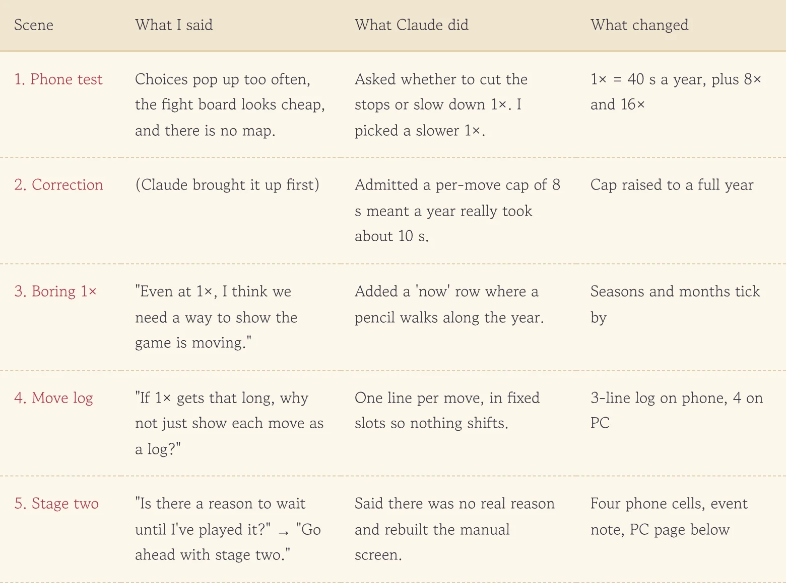
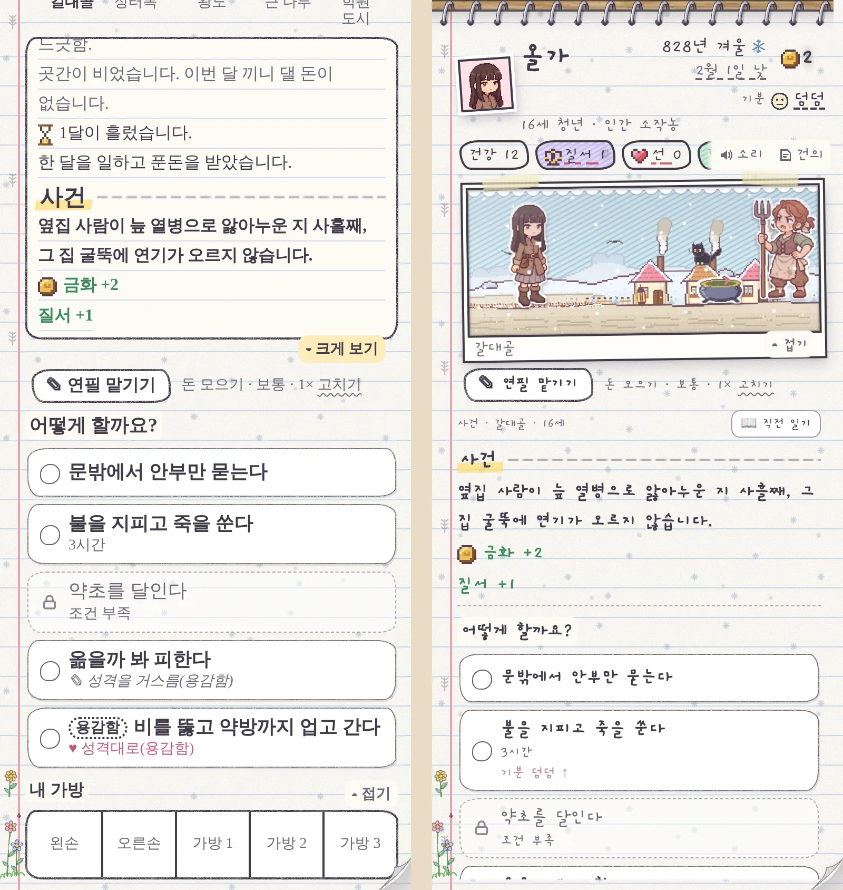
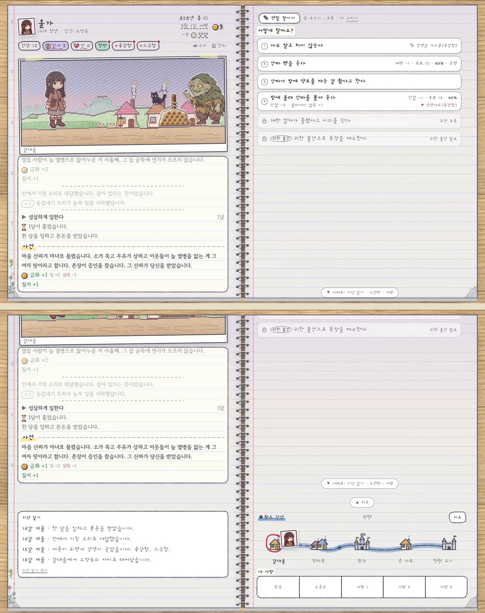
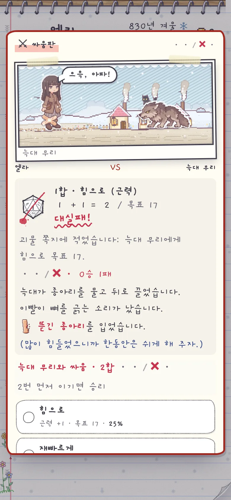

In the morning we shipped the sketchbook summary board, so I left it running on my phone for a good while. On a desk monitor it looked fine. In my palm it was another story. Choice notes kept popping up, the fight board looked flimsy, and the map that had clearly been in the morning's design was nowhere to be found. So I bundled all my grumbling into one message.

<figure><figcaption>One morning of grumbling rebuilt a whole screen by the evening.</figcaption></figure>

## Fewer stops, or a slower clock?

When I said choices popped up too often, Claude didn't just patch it. It offered two roads: cut the number of stops, or slow 1× down so the stops spread out. It also pointed out that 16× in *1 in 8 Billion*, the game we've been borrowing ideas from, is roughly our old 1×. I kept the stops and slowed 1× down. Now a year takes 40 seconds at 1×, and 8× and 16× were added on top.

A little later Claude came back with a confession on its own. A per-move cap of 8 seconds meant a year of work was actually finishing in about 10 seconds. **Hearing "the 40 seconds I told you was wrong" before I noticed made me trust the numbers more, not less.** The cap is now a full year, so 40 seconds really is 40 seconds.

## Slow enough to look frozen

Slowing 1× created a new problem. The screen was so quiet I couldn't tell if the game was running or stuck. I said, "Even at 1×, I think we need a way to show the game is moving." Below the summary board, a year-long track appeared with a pencil slowly walking along it, seasons and months ticking past.

Watching that, I added one more thought: "If 1× gets that long, why not just show each move as a log?" So now every move the pencil makes adds a line to a small log. The slots are locked in advance, so new lines don't shove the page around, and the layout-shift score stayed around 0.001.

## Is there a reason to wait?

The plan was to use the sketchbook for a few days before reworking the hands-on screen (stage two). Then I got curious and asked, "Is there a reason to wait until I've played it?" Claude's answer was short: it was just the order in the design, no real reason to wait. So: "Go ahead with stage two."

The first thing fixed was an event on the phone. Before, once you read the event text, the choices sat below the fold and you had to scroll a long way. **Now the screen is locked into four cells (profile, scene, diary, choices), and when an event comes the diary folds away and the choice cell becomes an event note.** The event text and choices fit in one view, and "📖 Just before" opens the three lines that led up to it. Under each choice you also see how your mood will shift, like "Mood: Plain ↑".

<figure><figcaption>Same event, same moment. On the left you had to scroll to choose; on the right it's all there from the start.</figcaption></figure>

## On PC, the whole right page

On the two-page PC notebook, the whole right page is now the choice cell. The route board, the bag and the past diary sit just below the two pages, reached with "▼ Below" or the scroll wheel. Long to-do lists are split into tabs by group (Work, Learn, Rest…), so there's far less hunting around the page.

<figure><figcaption>Top is the first view; bottom is after pressing "▼ Below".</figcaption></figure>

## The fight board, by hand too

The fight board we built for auto play now also opens when you play by hand. It reuses the scene frame, so you and the wolves trade blows up top, with last round's dice and the move buttons beside it. If you can't be bothered, "Hand this fight to the pencil" inside the board does the rest. One funny bug: the first time it opened on PC, the notebook's spiral binding was drawn right across the board. Drawing the board outside the page fixed it.

<figure class="narrow"><figcaption>Same fight board when you play it yourself.</figcaption></figure>

Some things are left for later. Showing the result inside the phone's event note with a "Next →" button, and flipping the sketchbook cover, will wait until I've used this screen for a few days.

## Three-line summary

1. 1× now takes 40 seconds a year without touching the number of stops, and a walking pencil plus a per-move log show that the game is still running.
2. The hands-on phone screen is locked into four cells, the choice cell turns into an event note when something happens, and on PC the whole right page is for choices.
3. Even with a planned order, ask "do we really have to wait?" If there's no reason, the AI will tell you so.
