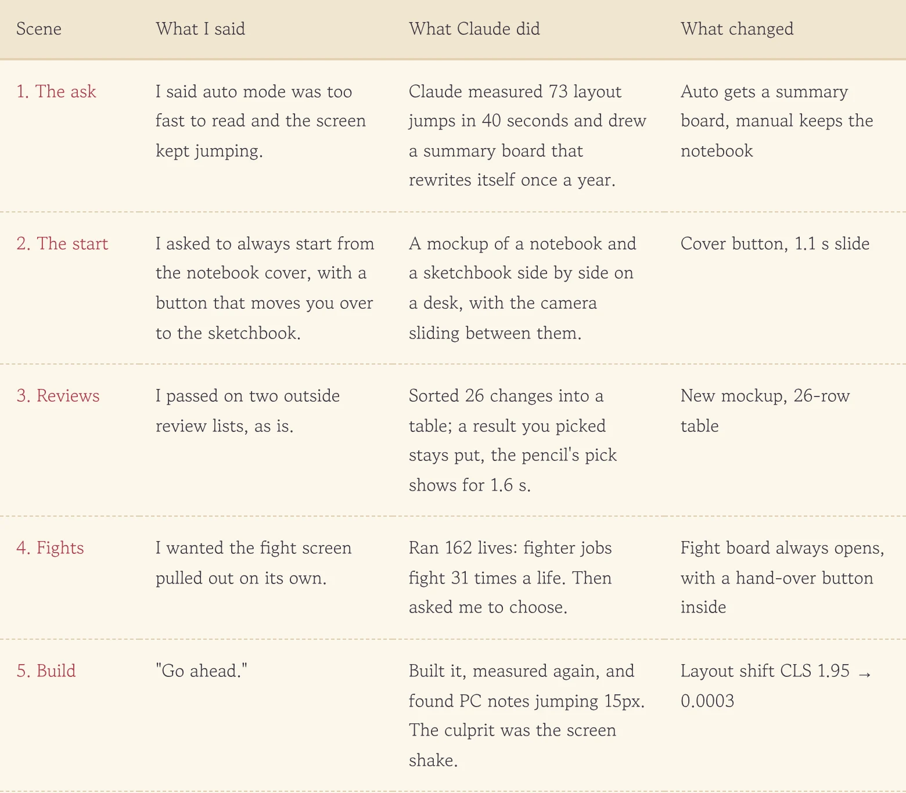
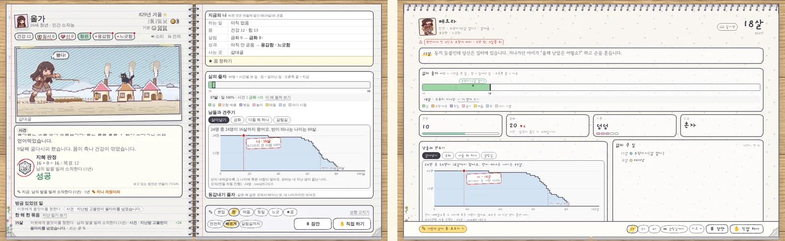
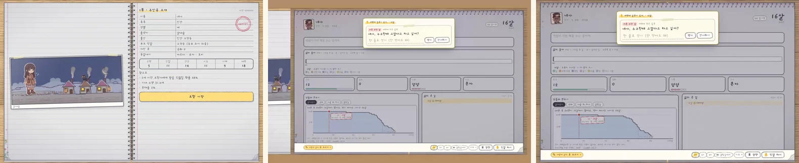
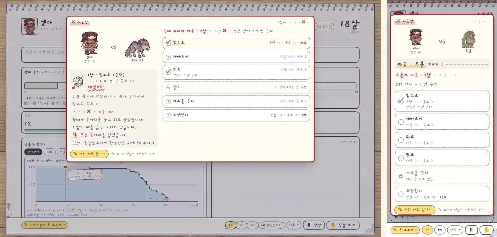
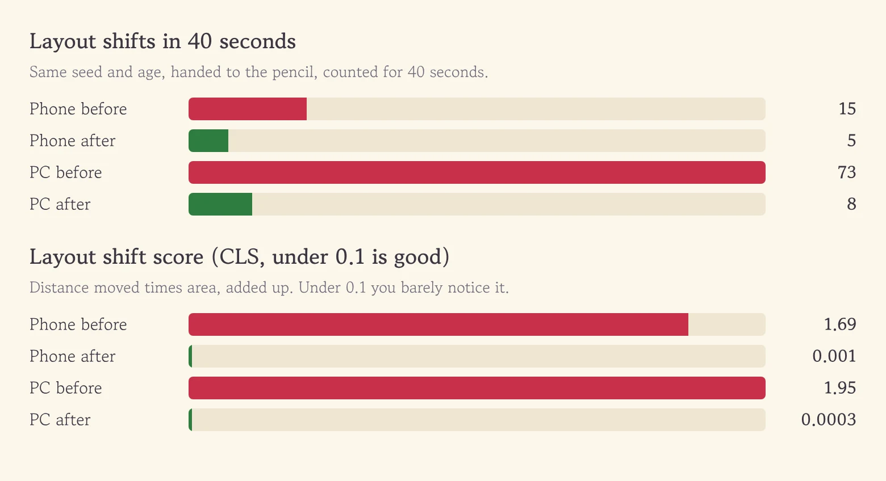

Our RPG has a button called "Let the pencil write"—press it, and an autoplay bot plays your character's life for you. The problem was that this pencil was way too caffeinated. Text flew past before I could read it, and the whole screen kept lurching. Those two gripes were all I sent to Claude.

<figure><figcaption>One grumble turned into the fourth revision of a design doc.</figcaption></figure>

## Turning "feels choppy" into a number

All I said was that the screen felt jittery. Claude measured the annoyance first: same baby, same age, 40 seconds of autoplay.

On PC, the layout shifted **73 times**—nearly twice a second, every new line shoving the UI down a notch. **Once "annoying" became "73," the fix was obvious:** stop streaming text in autoplay and switch to a summary board that updates once a year.

<figure><figcaption>Left, the old waterfall of text. Right, the new summary board that rewrites itself once a year.</figcaption></figure>

## My notebook on the left, the pencil's sketchbook on the right

Next I slipped in a bit of personal indulgence. I wanted every run to still start on the notebook cover, and pressing "Let the pencil write" to slide the camera sideways onto a sketchbook sitting beside it—my notebook for playing by hand, the pencil's sketchbook for watching it draw, side by side on the same desk. Claude wired up the desk-slide transition, and after an outside review suggested letting players savor it once and keep it snappy afterward, we set the first slide to 1.1 seconds and every slide after that to 0.7 seconds.

<figure><figcaption>Press the pencil button on the cover and the desk glides sideways onto the sketchbook.</figcaption></figure>

## Careers that fight 31 times a lifetime

I also asked to break combat out into its own dedicated board. Before writing any UI, Claude simulated 162 lives and came back with a reality check: fighter careers average 31 battles per lifetime. Popping open a mandatory fight modal 31 times would completely wreck the point of autoplay.

Claude laid out the options on a card, and I picked **"always open, with a 'hand it over' button inside."** In the mood to trade blows? Pick your moves yourself. Feeling lazy? Tap "Let the pencil take this fight" right on the board and sit back. Only the desperate last-ditch move—when your life hangs in the balance—stays strictly a human call.

<figure><figcaption>My portrait versus the foe, the score, the move buttons, and "Let the pencil take this fight" at the bottom.</figcaption></figure>

## The surprise culprit: screen shake

I typed "start it," Claude built the lot, and then ran the 40-second shift check again. On PC, the choice note was still hopping 15 pixels at a time. Tracking down the bug turned up an absurd culprit: the **screen-shake effect** that jiggles the notebook whenever you take a hit or arrive at a new station. Every time the notebook frame shook, the choice note—supposed to stay pinned neatly to the viewport—got dragged right along with it.

Disabling screen shake inside the sketchbook sent our layout-shift score plummeting from 1.95 down to **0.0003**. The handful of tiny shifts left come from the yearly timeline ruler adding one cell per year, virtually invisible to the eye, so we left them alone.

<figure><figcaption>PC shifts dropped from 73 to 8, and the layout-shift score dropped to effectively zero.</figcaption></figure>

This round tackled autoplay only. The hands-on two-page notebook was supposed to wait until I'd lived with the sketchbook for a few days.

## Three-line summary

1. Autoplay traded its nonstop wall of text for a sketchbook summary board that updates cleanly once a year.
2. Combat now gets its own board, paired with an in-board button to hand any individual fight back to the pencil—essential for careers that fight 31 times a life.
3. When a UI feels subtly awful, have your AI measure it before redesigning. Counting "73 shifts" revealed both the right layout and the hidden screen-shake bug.
