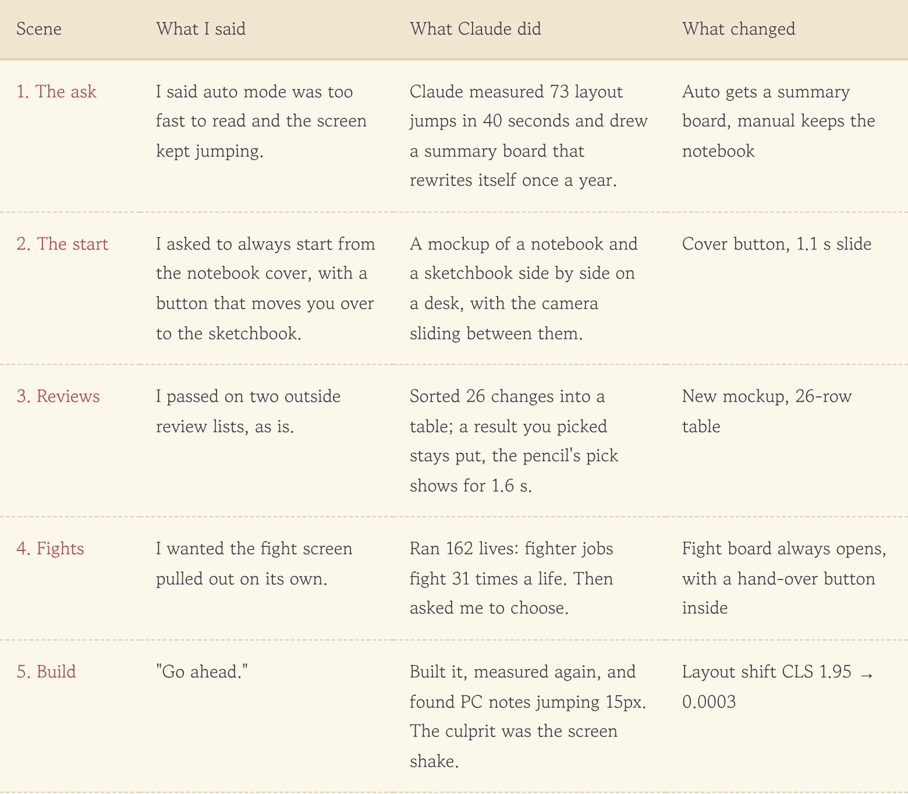
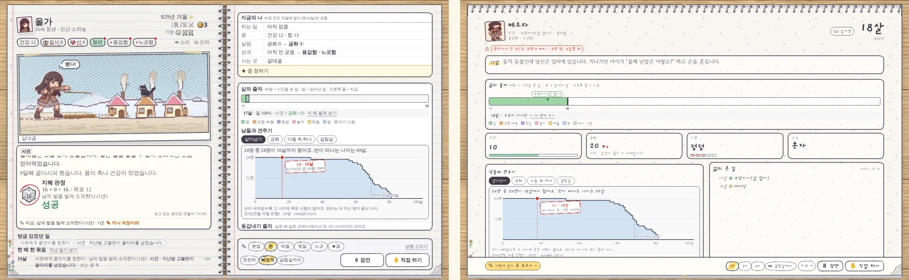
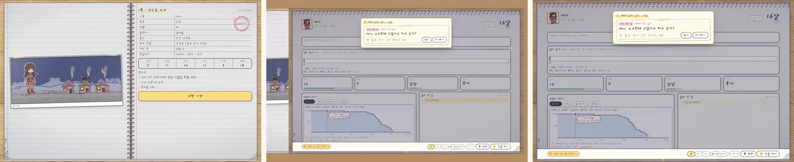
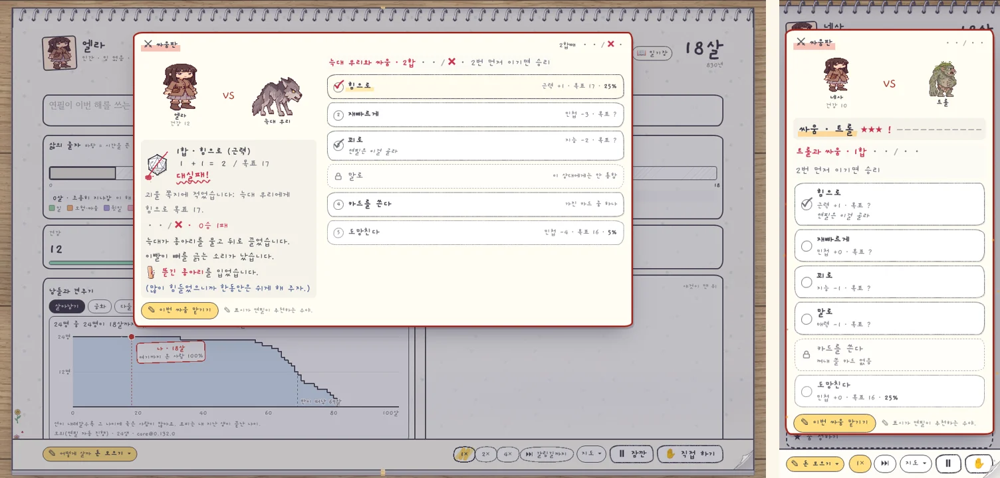
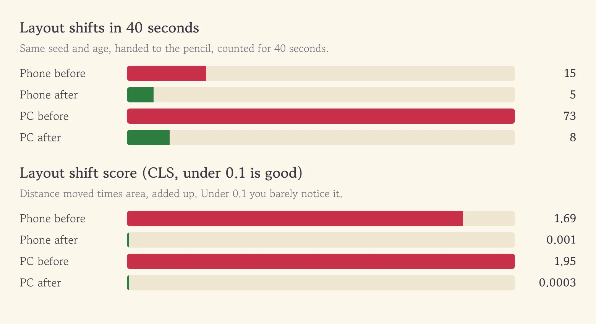

Our game has a button called "Let the pencil write." Press it and the pencil plays your life for you. The trouble was that the pencil was far too eager. Text flew past before I could read it, and the whole screen kept lurching. Those were the only two things I complained about.

<figure><figcaption>One grumble turned into the fourth draft of a design doc.</figcaption></figure>

## A feeling, turned into a number

All I said was that the screen felt choppy. Claude measured the feeling first. It handed the same baby, at the same age, to the pencil and counted how often the layout shifted in 40 seconds. On PC: 73 times. Every new line of text shoved everything below it down a notch. **Once "annoying" became "73," the fix was obvious.** In auto mode, stop streaming text and show a summary board that rewrites itself just once a year.

<figure><figcaption>Left, the old waterfall of text. Right, the new board that updates once a year.</figcaption></figure>

## The notebook is mine, the sketchbook is the pencil's

Then came my wish list. I wanted the game to keep starting from the notebook cover, and when I press the pencil button, the view should slide over to a sketchbook lying next to it—my notebook where I write myself, and the pencil's sketchbook where it draws for me, side by side on one desk. Claude added a desk slide, and since an outside review suggested going slow the first time and quick after that, it runs 1.1 seconds once and 0.7 seconds from then on.

<figure><figcaption>Press the pencil button on the cover and the desk slides sideways.</figcaption></figure>

## People who fight 31 times a life

I also asked for fights to get their own screen. Instead of building it right away, Claude ran 162 lives first and found that fighter jobs fight about 31 times per life. A popup every time would defeat the point of handing over the controls. So it laid the options out on a card, and I picked "always opens, with a 'hand it over' button inside." Want to watch? Play the moves yourself. Can't be bothered? Hand that one fight to the pencil from inside the board. Only the last-ditch push, where your life is on the line, always stays my call.

<figure><figcaption>Me versus the foe, the score, the move buttons, and "Let the pencil take this fight" at the bottom.</figcaption></figure>

## The culprit was the screen shake

After I said "start it," Claude built everything and measured again. On PC, the choice note was still jumping 15px at a time. The culprit turned out to be the effect that shakes the notebook when you take a hit or arrive somewhere new. While the frame shook, a note that should have been pinned to the screen got dragged along with it. Turning the shake off in the sketchbook dropped the shift score from 1.95 to 0.0003. The few shifts left come from the ruler growing one cell a year, which the eye barely notices, so we left them alone.

<figure><figcaption>Shifts went from 73 to 8, and the score dropped to almost zero.</figcaption></figure>

This round covered auto mode only. The hand-turned two-page notebook comes next, after I've used the sketchbook for a few days.

## Three-line summary

1. Auto-play no longer streams text. It shows a sketchbook summary board that rewrites itself once a year.
2. Fights always get their own board, and you can hand just that fight to the pencil from inside it.
3. When a screen feels off, ask the AI to measure it first. The number 73 pointed to both the fix and the culprit.
