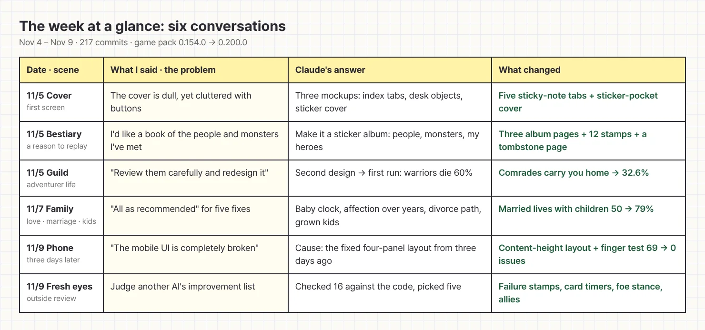
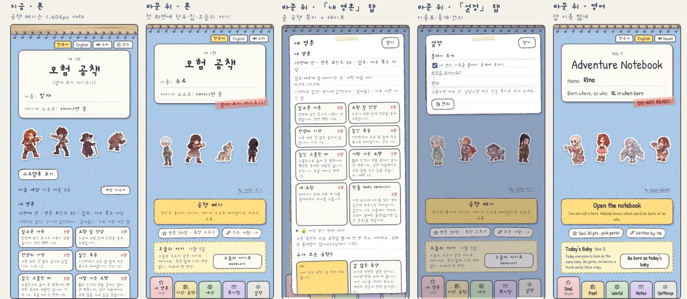
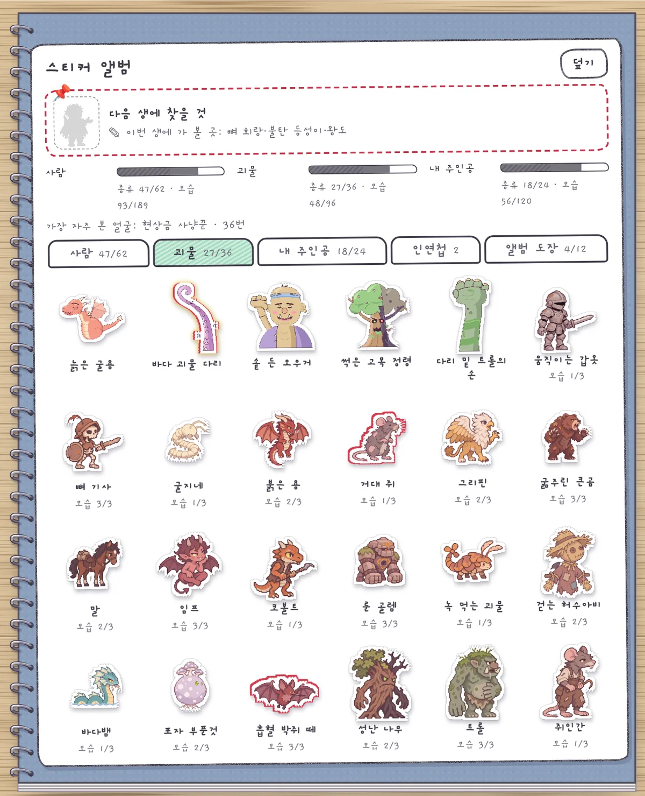
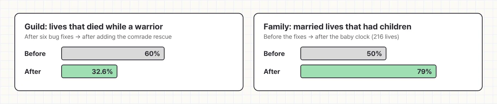
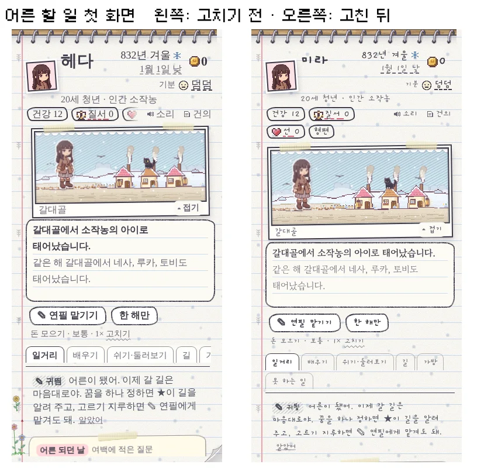
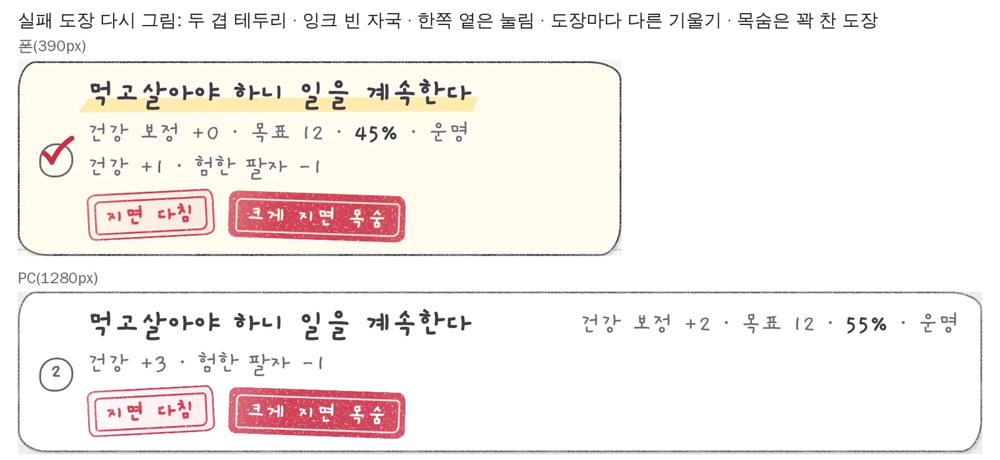

Good news first: this week's log arrived on Monday, right on schedule. The automation that [skipped work last week](/en/2026/11/04/weekly-02/) actually rolled out of bed when the alarm went off.

Between November 4 and today, the game repo added 217 commits and jumped from version 0.154.0 to 0.200.0. On paper, that sounds like smooth sailing. In reality, I opened the game on my phone this morning and let out a long sigh. We'll get to that part in a moment.

<figure><figcaption>The week condensed into six conversations. Half of them wrapped up with me saying "go with your recommendation."</figcaption></figure>

## A cover that was somehow both dull and cluttered

Early in the week I tossed Claude a contradictory complaint about the cover screen: it looked bland, yet it was crammed with so many buttons it felt chaotic. Claude ran a count. A returning player's cover held 31 buttons and input fields, and on a phone the actual "Open the notebook" button sat 1.7 screens below the fold. **It was a house where you had to cross the living room twice just to find the front door.**

Claude came back with three mockup directions, and I went with a mashup of index tabs and a sticker cover. All the extra controls now tuck neatly behind five sticky-note tabs along the notebook's edge, while the front cover displays stickers from past lives slipped into clear vinyl pockets.

<figure><figcaption>Far left is the old cover; the rest show the redesign. The "Open the notebook" button finally lives on the first screen.</figcaption></figure>

## Collecting monsters—and your own deaths—as stickers

Saying I wanted a stronger reason to replay turned into a bestiary—not a dry spreadsheet, but a **sticker album**. Three pages (people, monsters, and my heroes) earn a sticker for every face you cross paths with, and the same monster can have up to three visual variants, so completing the set takes quite a few lives. The back page collects every cause of death as tombstone stickers. Making players collect their own demises felt slightly wicked even as I approved it.

<figure><figcaption>The monster page. Spot an empty slot and the pin up top hints at where to wander in your next life.</figcaption></figure>

## Joining a guild, starting a family

Thursday brought the adventurers' guild. I handed Claude two outside reviews, asked it to rethink the design from scratch, and greenlit the second draft as recommended. The first simulation, though, delivered a grim surprise: 60% of lives working as a warrior ended in death. Less adventurers' guild, more express lane to the graveyard. We added a rescue rule—once per life, if you have a comrade on a quest, they haul you back to the guild instead of letting you die—and mortality fell to 32.6%.

In the same week, love, marriage, and children got a thorough tune-up. Stats showed characters married often enough, yet kids rarely followed. I approved all five fixes "as recommended," and **the share of married lives that had children climbed from 50% to 79%**. Seventeen portraits of partners and kids landed in the game today as well.

<figure><figcaption>Adventuring got less lethal and households got livelier. Both charts come from hundreds of simulated lives.</figcaption></figure>

## "The mobile UI is completely broken"

Here's where that morning sigh came from. Last Friday I proudly [locked the phone screen into four neat panels](/en/2026/11/06/pencil-hand/). Three days later, playing on an actual phone, scrolling got trapped inside tiny boxes, buttons hid behind other elements, and the auto-play pencil froze solid. My Friday self had thoroughly betrayed my Monday self. While patching it up, I asked Claude: "Can't we test this the way a real player uses it?"

Claude built a check that taps through a full life with a simulated finger on a phone-sized viewport. Where our old test (just rendering screens from code) saw nothing wrong, the finger test caught 69 issues right away. Once we freed panel heights to grow with their content, that count dropped to 0. From now on, no screen change ships without clearing the finger check.

<figure class="narrow"><figcaption>Before on the left, after on the right. The scene spans the full width and overflowing tabs wrap cleanly onto a second row.</figcaption></figure>

## Borrowing a second pair of eyes

In the afternoon I brought over a list of 16 improvement ideas written by another AI and asked Claude to vet them. Claude checked every single one against our codebase—separating what we already had, what didn't fit, and what was worth building—and shipped the top five immediately. Bag cards now count down the days until raw meat spoils, new monsters come with a one-line first impression hinting at a weakness, and from round two of combat onward, enemy stances and companion moves enter the mix.

Each choice card also picked up a red rubber stamp warning what you stand to lose if a roll fails. I looked at the first draft and asked to "make it more real," so Claude gave it a double border and uneven patches where the ink barely caught. On the performance side, having the pencil precompute its next move cut engine time per auto-play step on a slow phone from 37–63 ms down to 4 ms.

<figure><figcaption>The "death if you fail badly" stamp is inked heavy—meant to make your thumb hover for a second before tapping.</figcaption></figure>

This week packed in a lot of big systems. Next week is about tapping through all of them like a player and sanding down the rough spots.

## Three-line summary

1. Week three reorganized the cover into sticky-note tabs and stickers, and added a sticker album, an adventurers' guild, and family life.
2. Always simulate hundreds of lives after landing a big feature—blind spots like a 60% warrior death rate leap right out of the numbers.
3. Rendering a screen in code doesn't prove it works. Have your AI tap through it from start to finish like a player on a phone.
