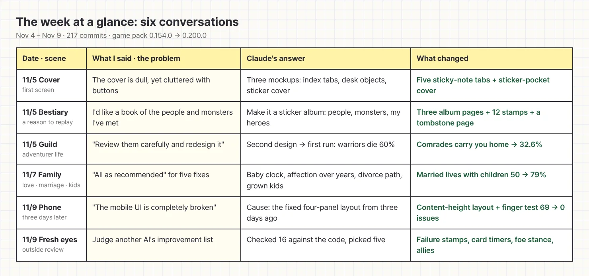
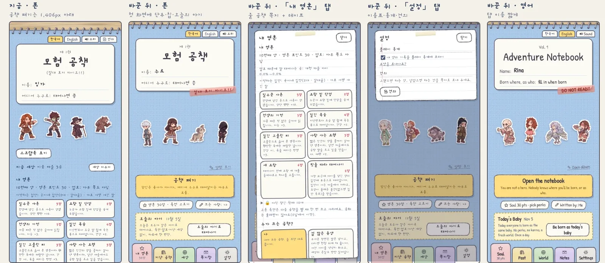
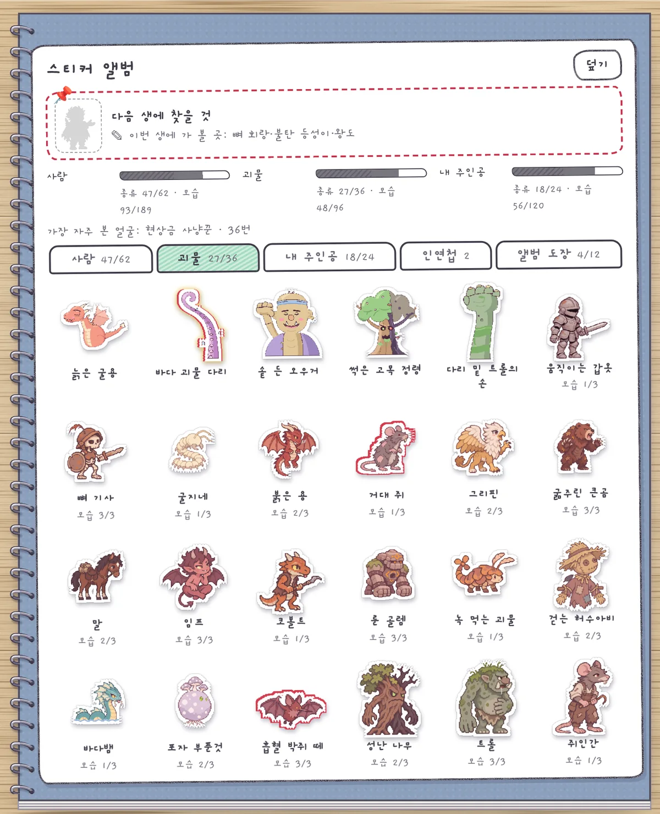
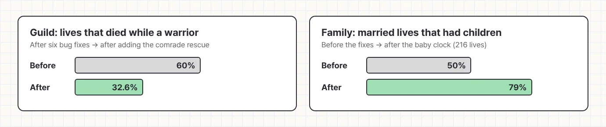
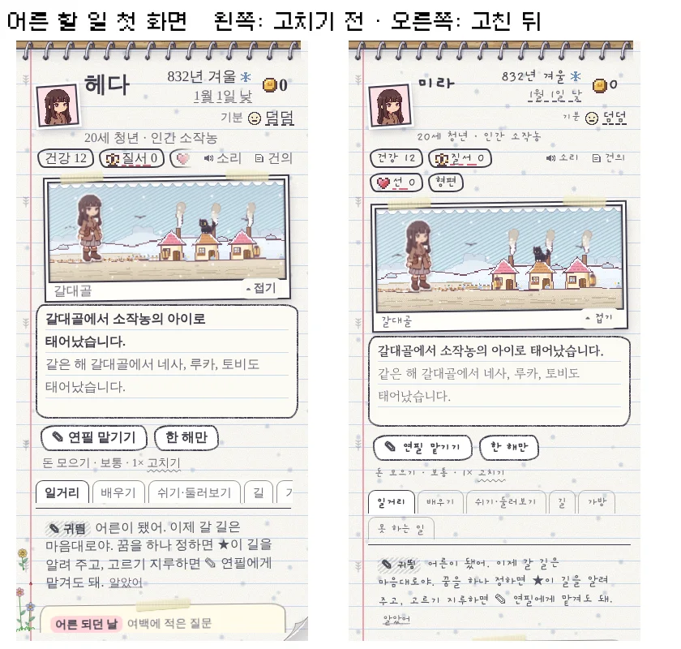
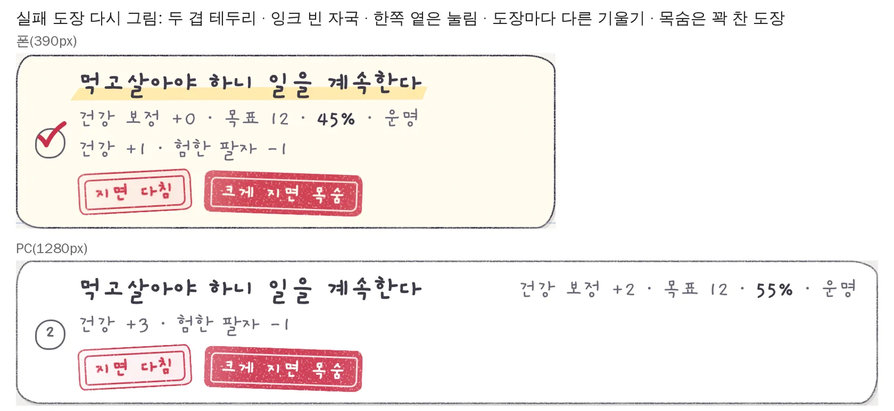

This week's log showed up on Monday, right on time. The schedule that [skipped work last week](/en/2026/11/04/weekly-02/) actually got up when the alarm rang. From November 4 to today the game repository gained 217 commits, and the game pack went from 0.154.0 to 0.200.0. On paper that looks like smooth sailing, but this morning I sighed the moment I picked up my phone. I'll get to that.

<figure><figcaption>The week in six conversations. Half of them ended with "go with your recommendation."</figcaption></figure>

## A cover that was both dull and cluttered

Early in the week I made a contradictory complaint about the cover: it looked dull, yet it had so many buttons it felt messy. Claude counted, and a returning player's cover had 31 buttons and input fields, while on a phone the actual "Open the notebook" button sat 1.7 screens down. **It was a house where you had to walk through the living room twice to find the front door.**

After seeing three directions of mockups, I picked a mix of index tabs and a sticker cover. All those features now live behind five sticky-note tabs on the side of the notebook, and the cover shows stickers from past lives tucked into vinyl pockets.

<figure><figcaption>Far left is the old one, the rest is the new cover. The open-notebook button finally made it onto the first screen.</figcaption></figure>

## Collecting monsters as stickers

When I said I wanted a reason to play again, a bestiary came out of it. Not a plain table, but a **sticker album**. Three pages (people, monsters, and my heroes) get a sticker for every face you meet in a life, and the same monster can have up to three looks, so filling it takes quite a few deaths. The very back has a last page that collects causes of death as tombstone stickers. A game that makes you collect your own deaths felt a little mean even while I was making it.

<figure><figcaption>The monster page. If you see a gap, the pin at the top hints where to go next life.</figcaption></figure>

## Joining a guild, and getting married

Thursday brought the adventurers' guild. I attached two outside reviews and said "Review them carefully and redesign it," then went ahead with the second design as recommended. The first measurement, though, showed 60% of lives dying while working as a warrior. So once per life, if you have a comrade on the quest, they carry you back to the guild instead of you dying, and the number dropped to 32.6%.

The same week, love, marriage and children got a big overhaul. A check showed people married but rarely had kids. I approved all five fixes "as recommended," and **married lives that had children went from 50% to 79%**. Seventeen pictures of partners and children also went into the game today.

<figure><figcaption>Adventuring got safer and homes got busier. Both numbers come from hundreds of simulated lives.</figcaption></figure>

## "The mobile UI is completely broken"

This was this morning's sigh. Last Friday I proudly [locked the phone screen into four panels](/en/2026/11/06/pencil-hand/), but holding it in my hand, scrolling only happened inside the panels, buttons got covered, and the pencil froze. My past self from three days ago had betrayed me. While fixing it I asked one more thing: "Can't you check it from the player's side?"

Claude built a check that taps through a whole life with a finger on a phone-sized screen. Before the fix it found 69 problems the old check (just loading screens from code) had missed, and after letting panels grow with their content it found 0. Now any screen change has to pass this check before it ships.

<figure class="narrow"><figcaption>Left is before, right is after. The scene fills the width and the tabs wrap when they run out of room.</figcaption></figure>

## Looking again through someone else's eyes

In the afternoon I brought in an improvement list another AI had written and asked Claude to judge it. Claude checked all 16 items against the code, sorted out what already existed, what we wouldn't do and what was new, and put in the top five right away. Bag cards now show how many days are left before raw meat spoils, a monster you meet for the first time gets a one-line first impression that hints at its weak spot, and from the second round of a fight the enemy's stance and your companion's move come into play.

Under each choice, a red rubber stamp now shows what you lose if you fail. When I saw the first version I said "make it more real," and it got a double border and even patches where the ink didn't take. On top of that, the pencil now precomputes its next move, so engine time per auto-play move on a slow phone fell from 37–63 ms to 4 ms.

<figure><figcaption>The "death if you fail badly" stamp is fully inked. Think twice before you tap.</figcaption></figure>

This week brought in a lot of big pieces, so next week I plan to tap through them again with a player's fingers and polish.

## Three-line summary

1. In week three the cover got sorted into sticky-note tabs and stickers, and a sticker album, an adventurers' guild and family stories came in.
2. After adding a big feature, measure it over hundreds of simulated lives. Problems you can't see by eye, like a 60% warrior death rate, jump out as numbers.
3. Loading screens from code isn't enough. Ask your AI to "tap through it with a finger, like a player."
