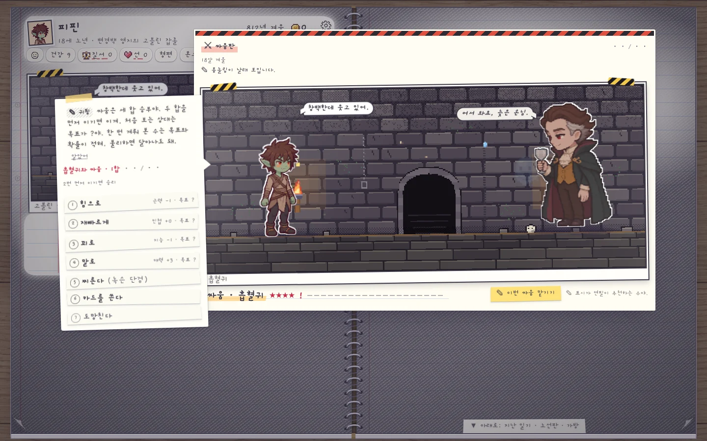

There was one sentence I couldn't stop repeating all week: "It looks fine, yet something still feels empty."

Picking up from [last week](/en/2026/11/09/weekly-03/), the repo added 181 commits between the afternoon of November 9 and today, moving the version from 0.200.0 to 0.244.0. Almost all of them went into filling those empty spaces, one detail at a time.

<figure><figcaption>The week in six conversations—half of them crammed into a single Tuesday.</figcaption></figure>

## "Use Fable 5.2 to make the game visually richer"

On Tuesday I placed that exact order, model name included. Claude redrew all 24 regional backdrops pixel by pixel in code. Market stalls sprouted striped awnings, and the royal city gate gained a heavy iron portcullis. Characters now cast soft shadows at their feet, lamplight warms their faces at night, fireflies drift across summer evenings, and snow actually settles on the ground in winter.

It took a couple of passes to get right. At first petals and snowflakes buried the screen, so I said "too many particles." Thinning them out revealed a new quirk: they repeated in three identical vertical strips. **Fewer bits, scattered unevenly** was Tuesday's design rule. We also tried synthesizing rain audio in code twice, but both attempts sounded uncanny, so our recorded rain stays.

<figure><figcaption>Old on the left, new on the right. Exact same towns, except now it looks like people actually live there.</figcaption></figure>

## The vampire talks back

The same day, the fight board got a makeover. I asked to make the character panel bigger and put it up top; Claude came back with five mockups, and I picked option E, which lays the combat board straight over the scene art. Choices now pop out as speech-tail notes from your hero's mouth, and the dice tumble right across the note you tap.

While we were in there, idle combat banter ballooned from 58 lines to roughly 830, and the 13 foes capable of speech now answer back. Initially the two speech bubbles piled on top of each other, so I flagged the overlap—now everyone waits their turn to speak. **Even brawls have manners now.**

<figure><figcaption>"Welcome, late guest." The vampire gets the first word in—not exactly a warm greeting.</figcaption></figure>

## A rich adventurer with nowhere to spend

Live long enough in the notebook and gold piles up with nothing left to buy. It felt like carrying a stuffed wallet through a town with no shops. I brought the problem to Claude, got two design proposals back, and greenlit option two.

Now you can fund a village well with your name carved on it, or hire a housekeeper. You can build a granary for famine years, a stone bridge across the river, or a coastal lighthouse. A soul that finishes a public project in one life keeps a stonemason contact and pays less to build in the next. There's even a grand almshouse that only goes up when multiple generations pitch in on their deathbeds. When we ran the numbers, one modest well saved a remarkable number of children.

<figure><figcaption>Put gold into the town and the town changes. One well broke the chain from poverty to tragedy.</figcaption></figure>

## A mini-game for every trade

On Wednesday I asked for each profession to have its own little game. I passed along design reviews from two other AIs, and Claude weighed them carefully before drafting a fresh spec. First out the door was the peddler's haggling board. You only get a handful of exchanges, so you're constantly judging how hard to push the price and when to shake hands. On desktop the market stall took up too much real estate, so a quick "shrink the stall a bit" brought it into balance.

The next day brought the blacksmith's forge board. You roll two dice to hammer nine slots along a blade; fill all nine and you walk away with a named masterwork. I asked for a completely different feel from haggling, and Claude swapped silver-tongued bluffing for the ring of hammer on steel.

<figure><figcaption>The haggling board. Ask for more and the odds shrink; miss your pitch and the buyer comes back with a lowball.</figcaption></figure>

## My iPhone turned into a hand warmer

Wednesday also brought a hardware gripe. Testing on my iPhone, popups dragged, the bottom of the screen flashed white on scroll, and the back of the phone ran alarmingly hot.

Claude tracked down three culprits: stacked drop-shadows on scrolling containers, animations still humming away off-screen, and a cache setting that re-downloaded images on every visit. After cleaning up all three, the phone's idle workload over a 4-second window dropped from 2.7 seconds down to 0.9.

The loading screen got a fresh coat of paint too. I mentioned that the scribbling pencil felt charming, so now a pencil sketches the boxes on blank paper and writes the title letter by letter while the game loads. Waiting suddenly feels a lot less like waiting.

<figure class="narrow"><figcaption>The pencil draws the cover from scratch. The moment loading finishes, it cuts straight into the game even mid-stroke.</figcaption></figure>

Rounding out the week, we added the "bookbag"—a carry-over slot that lets you tuck one line from your notebook into your next life—and built a dialogue workbench that pulls every line in the game into one place for a sweeping rewrite. Next week I'll put the new job boards through their paces and start tuning the numbers.

## Three-line summary

1. Week four delivered 24 redrawn backdrops, village public works to sink surplus gold into, job-specific mini-games, and the bookbag.
2. When tuning visual effects, plain gut feedback like "too many" or "too regular" is plenty for AI to nail the fix.
3. Even a vague complaint like "my phone gets hot" is worth handing over—once AI hunts down the causes and measures them, the fix becomes obvious.
