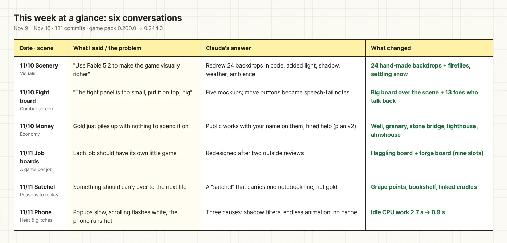
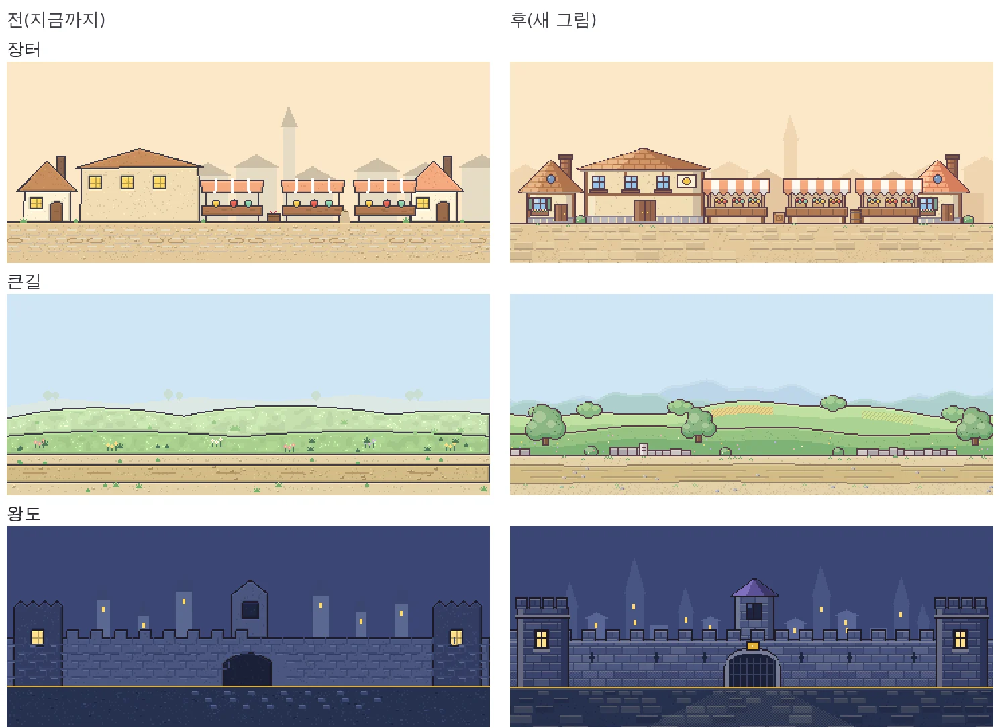
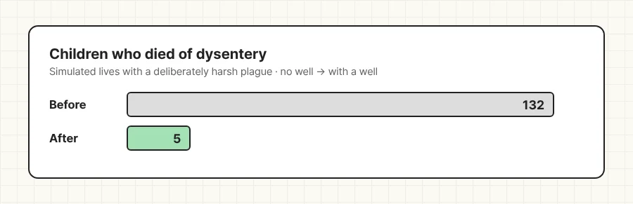
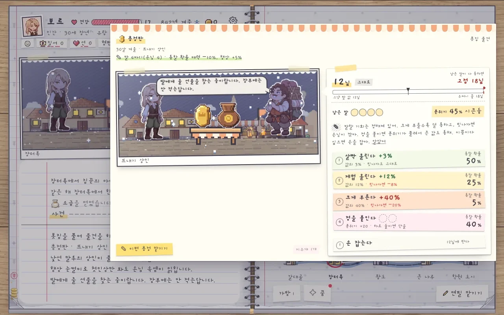
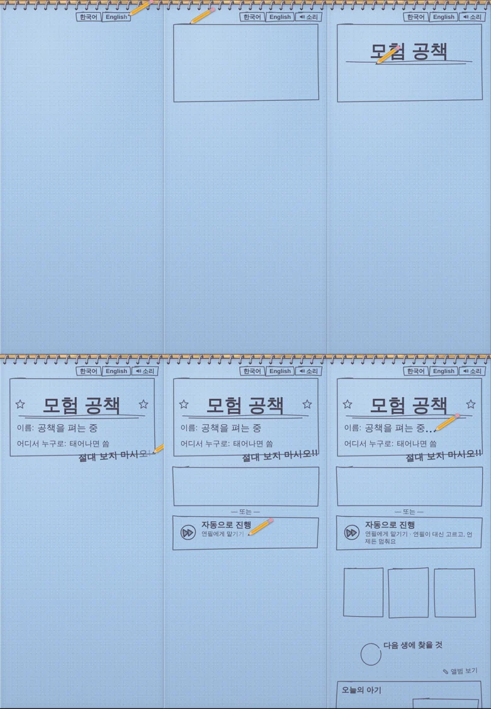

Here's week four, picking up from [last week](/en/2026/11/09/weekly-03/). From the afternoon of November 9 to today the game repository gained 181 commits, and the game pack went from 0.200.0 to 0.244.0. This week I kept saying the same thing in different words: it looks fine, but something feels empty. So we spent the week filling in the empty bits, one at a time.

<figure><figcaption>The week in six conversations. Half of them happened on Tuesday.</figcaption></figure>

## "Use Fable 5.2 to make the game visually richer"

On Tuesday I put in that order, model name and all. Claude redrew all 24 regional backdrops pixel by pixel, in code. The market stalls got striped awnings and the royal city gate grew an iron portcullis. Characters now cast a shadow at their feet, lamplight touches their faces at night, fireflies drift through summer evenings and snow actually piles up in winter.

It didn't land in one go, of course. At first petals and snowflakes buried the whole screen, so I said "too many particles." Once they were thinned out, I noticed they repeated in three identical strips. **Fewer bits, scattered unevenly** was the lesson of the day. We also tried a rain sound made in code twice, but it sounded off both times, so the recorded rain stays.

<figure><figcaption>Old on the left, new on the right. Same places, but it looks like people finally moved in.</figcaption></figure>

## The vampire talks back

The same day I fixed up the fight board. I said "the fight panel is too small, put it on top, big," got five mockups back, and picked option E, which lays the board right over the scene art. Your moves now pop out as speech-tail notes from the hero's mouth, and the dice roll right on top of the note you picked.

While we were at it, the idle lines you hear when you just stand there mid-fight grew from 58 to about 830. The 13 foes that can talk now answer back. At first the two speech bubbles stacked on top of each other and I complained the lines overlapped, so now only one person speaks at a time. **Even fights have manners now.**

<figure><figcaption>"Welcome, late guest." The vampire says hello first. Not a warm hello.</figcaption></figure>

## The rich man's problem

Live long enough and gold keeps piling up with nowhere to spend it. It felt like having a fat bank account in a town with no shops. When I brought this up, Claude wrote the design twice and I said to go with version two.

Now you can dig a well with your name on it or take on a housekeeper. You can also build a granary for lean years, a stone bridge over the river and a lighthouse on the coast. A soul that saw a project through in a past life knows a stonemason and pays less for building next time, and there's a great almshouse that only goes up when life after life chips in on their deathbeds. When we measured it, a single well saved a surprising number of children.

<figure><figcaption>Spend the money and the village changes. Gold cuts the chain that led from poverty to death.</figcaption></figure>

## A small game for every job

On Wednesday I said I wanted each job to have its own little game. I handed over reviews from two other AIs, and Claude compared them carefully and redid the design. First up is the peddler's haggling board. You only get a few words in, so you have to think about how hard to push the price and when to shake hands. On PC the stall was too big, so I asked to "shrink the stall a bit."

The next day the blacksmith's forge board arrived. You roll two dice to hammer nine slots of a blade, and filling all nine gives you a masterwork with your name on it. I'd asked for something that felt different from haggling, and it came back as a board that rings with hammer blows instead of talk.

<figure><figcaption>The haggling board. The higher you ask, the less likely it works, and if you miss, the customer comes back with a lowball.</figcaption></figure>

## My phone turned into a hand warmer

On Wednesday I also grumbled after playing on my iPhone. Popups were slow, the bottom flashed white every time I scrolled, and the phone got hot. Claude found three culprits: stacked shadow effects on scrolling panels, animations that kept running even off screen, and a setting that downloaded the pictures again on every visit. After the fix, the work the phone does while sitting idle dropped from 2.7 seconds to 0.9 seconds in a 4-second window.

The loading screen changed too. I said the pencil scribbling was fun, so now a pencil rules the boxes and writes the title one letter at a time, like a rough sketch. Waiting got a little less boring.

<figure class="narrow"><figcaption>The pencil draws the cover from scratch. When loading finishes, it moves on even mid-sketch.</figcaption></figure>

Besides all that, a "satchel" arrived that lets you carry one line of your notebook into the next life, and late in the week a dialogue workbench showed up that finds every line in the game in one place, which I used for a big rewrite. Next week I plan to play these new boards myself and tune the numbers.

## Three-line summary

1. Week four redrew 24 backdrops and added public works for your gold, job boards and a satchel.
2. When you add effects, tell the AI exactly what you feel, like "too many" or "too regular." That one remark gets you surprisingly precise fixes.
3. Hand "my phone gets hot" straight to the AI too. Once it finds the causes and measures them, it's clear what to fix.
