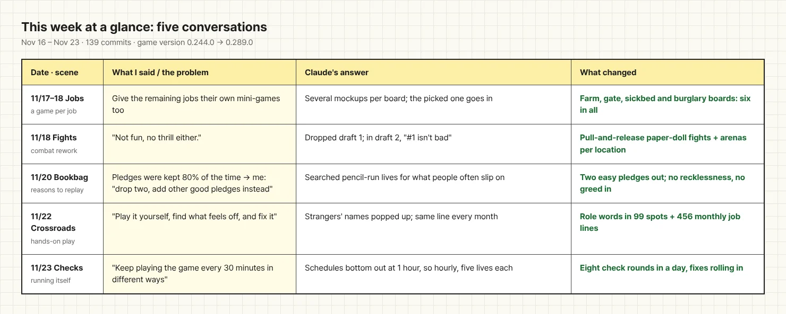
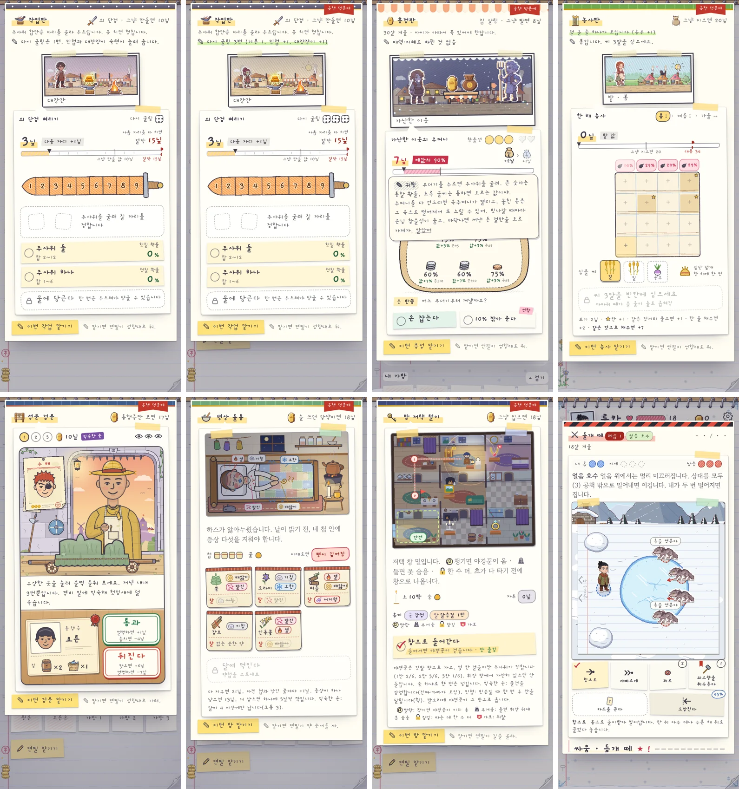
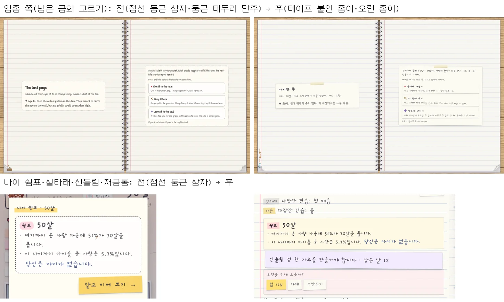

If I had to pick one phrase I typed most this week, it would be: *"Go play it yourself."* Instead of just signing off on mockups from the director's chair, I spent week five pushing Claude into the player's seat.

Picking up from [last week](/en/2026/11/16/weekly-04/), the game repo logged 139 commits between the evening of November 16 and today, taking the version from 0.244.0 to 0.289.0.

<figure><figcaption>The week in five conversations. That bottom row is still running on its own as I write this.</figcaption></figure>

## Six job boards, finally lined up

Last week's two job mini-games—haggling and the forge—gained four companions this week. Farmers plant seeds across a graph-paper field, and city guards lift cart tarps at the gate hunting for contraband. Herbalists brew remedies through the night to clear five symptoms off a feverish patient, while thieves slip through a mansion between the night watchman's lantern sweeps.

For every board, Claude sketched several mockups and I picked the direction. The gate-inspection board alone went through eight framings before landing on the view from inside the guard booth looking out. **With all six boards lined up, picking a profession finally feels like choosing which little game you want to play.**

<figure class="narrow"><figcaption>Top row: forge, haggling, and farm. Bottom row: gate, sickbed, burglary, and the new fight board. Half a school desk's worth of paper games, stuffed into one notebook.</figcaption></figure>

## "Not fun, and zero thrill"

Once the job boards started feeling lively, regular combat looked painfully dull next to them. Claude let the auto-play pencil mode run through 108 lives and logged 861 fights: players won 88% of the time, and 42% ended in a lifeless 2–0 sweep. Less mortal peril, more taking attendance.

So I asked for a full combat rebuild, and the heading above was my blunt reaction to draft one. It was a dice-placement puzzle that never felt like anything more than matching numbers.

Draft two earned a *"Number one isn't bad."* You pull your paper doll back with a finger and flick it across the page to knock the enemy off the notebook. I layered on a couple of twists: bigger, heavier monsters should be harder to budge, and the pieces should use our actual character art instead of generic round tokens.

That became the "paper-doll fight." The very next day, every location in the game got its own arena with matching terrain—you skid across a frozen lake and ricochet off trees in the forest. Today all 23 enemy types gained weakness hints so matching cards light up with a "clue" tag.

<figure><figcaption>Each arrow points to that location's arena. No matter where you go, wolves still circle looking for an opening.</figcaption></figure>

## Players who kept their promises a little too well

The "bookbag"—the kit you carry into your next life—filled out nicely too, adding a dog-eared page, a homework notebook, and a class library. Meanwhile, the roster of alternate narrators who write your notebook for you (the timid little brother, the grumpy big brother) welcomed a new voice today: a chatty grandma.

The best discovery came from "pledges," where you tuck a promise into your bookbag as a bet with yourself. When we pulled the numbers, players were keeping their pledges 80% of the time without even trying. That's not a wager—that's a freebie. Claude offered to cut the two easiest ones, and I replied, *"Drop two, and bring in better pledges to replace them."* In came "don't be reckless" and "don't be greedy." **A promise only means something when it's tempting to break.** Turns out that holds true for games as much as for people.

<figure class="narrow"><figcaption>Let grandma write your notebook and monsters thin out while feasts multiply—told at her own unhurried pace.</figcaption></figure>

## "Play it yourself, find what feels off, and fix it"

A couple of months into any career, you now hit a first moral crossroads: cover up your boss's mistake, steal credit for a coworker's job, pocket a quiet bribe. Once all eight job groups had theirs wired in, I sent Claude off to play through them firsthand.

The report that came back was humbling. A character introduced as "the senior hand" in scene one reappeared in scene two simply as "Rine," leaving players guessing who on earth that was. Events that could trigger at any interval still had "four months later" hardcoded in the text. We patched 99 spots of the first slip and 61 of the second.

The next day I told Claude to keep digging, and another awkward habit popped up: stick with a month-long gig and the exact same sentence repeated month after month—up to 22 identical lines in a single lifetime. I asked for a fresh batch of monthly job text, and 69 jobs got 456 new lines.

<figure><figcaption>The hauling text is an illustrative example; the game collapses repeated monthly lines the exact same way.</figcaption></figure>

## Now the game playtests itself

Today I pushed the idea one step further and asked Claude to *"keep playing the game every 30 minutes in different ways and check it from every angle for bugs and polish."* Scheduled runs bottom out at one hour, so we settled on hourly. At first each pass lived a single life; partway through I bumped it up to five lives per check.

Eight rounds ran today alone, quietly fishing out real snags one by one: a dream-picker title hidden under the close button on phones, board hand-off buttons pinned underneath the bottom bar on the PC sketchbook. Along the way, we swapped out the last leftover dotted boxes across the UI for proper notebook craft—taped paper and cut-out scraps. **It feels like hiring a night watchman** who patrols the halls all night and never asks for a paycheck.

<figure><figcaption>Old dotted boxes spotted while playing a life from start to finish. Before on the left, after on the right.</figcaption></figure>

Around all that, the money economy went through three balancing passes—kids from poor households now send part of their wages home while their parents live, and poor-born crafters without a guarantor pay a guild fee to reach master rank. Your active notebook also survives game updates now, and the opening screen loads noticeably faster. Next week I'll keep working through whatever the hourly patrol drags in, and start dialing in win rates on the new paper-doll fight board.

## Three-line summary

1. Week five rounded out all six job boards, rebuilt combat into a paper-doll flicking game, and expanded the bookbag with tougher pledges and a new narrator.
2. When a mockup falls flat, say so plainly—telling AI "no fun, zero thrill" gets draft two dramatically closer.
3. Send your AI to actually play the game. It catches awkward phrasing and buried buttons far more diligently than a quick human skim.
