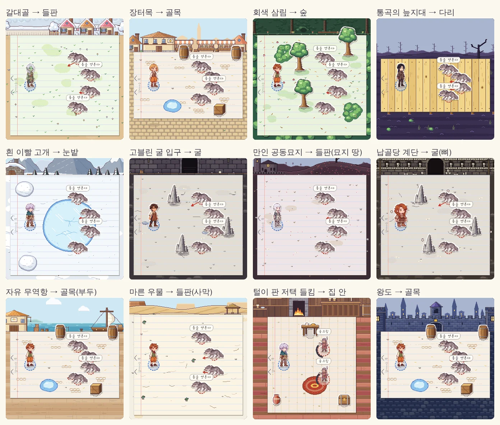
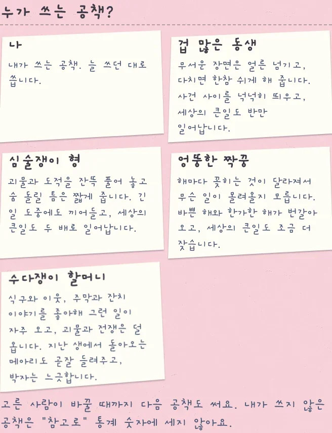
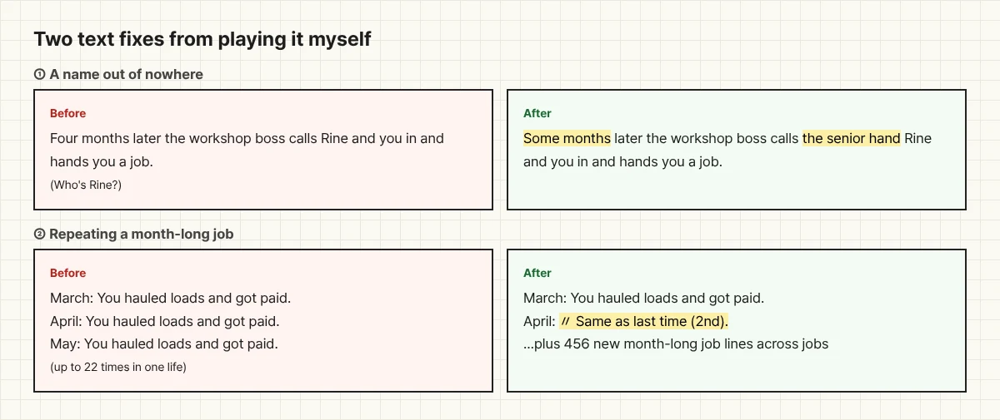

Here's week five, picking up from [last week](/en/2026/11/16/weekly-04/). From the evening of November 16 to today the game repository gained 139 commits, and the game version climbed from 0.244.0 to 0.289.0. If I had to pick the phrase I said most this week, it would be "go play it yourself." Instead of just picking from mockups, I kept sending Claude off to actually play the game.

<figure><figcaption>The week in five conversations. The last row is still running as I write this.</figcaption></figure>

## Six job boards, finally in a row

Last week the job mini-games started with two: haggling and the forge. This week four more joined. Farmers plant seeds on a graph-paper field, and guards lift cart covers at the city gate hunting for contraband. Herbalists brew remedies through the night to clear five symptoms from a feverish patient, and thieves slip through a mansion between the night watchman's lantern sweeps.

For each board Claude drew several mockups and I picked one. The gate board alone went through eight framings before it settled on the view from inside the booth looking out. **With six boards side by side, picking a job finally feels like picking which game to play.**

<figure class="narrow"><figcaption>Top row: forge, haggling and farm. Bottom row: gate, sickbed, burglary and the new fight board. The whole stationery shop moved into one notebook.</figcaption></figure>

## "Not fun, no thrill either"

Once the job boards got fun, the fights looked shabby next to them. Claude ran 108 pencil lives and counted 861 fights: the player won 88%, and 42% ended in a flat 2–0. So I asked to rebuild combat, and the heading above was my first reaction to draft one. It was a dice-placing game, and it never felt like more than matching numbers.

Draft two got a "#1 isn't bad" out of me. You pull your doll back with a finger and let go to flick the enemy off the page. I added a few asks: heavier, bigger monsters should budge less, and the pieces should be the actual character art instead of round tokens. That became the "paper-doll fight," and the next day every location in the game got its own arena. You slide on a frozen lake and bump into trees in the forest. Today all 23 enemy types got weakness clues, so the right card lights up with a "clue" mark.

<figure><figcaption>The arrow next to each place name points to its arena. The wolves circle you wherever you go.</figcaption></figure>

## Players who keep their promises too well

The "bookbag," the thing you carry into your next life, grew a lot this week too. A folded-down page, a homework notebook and a class library all arrived. And the slot for storytellers who write your notebook for you (the timid little brother, the grumpy big brother) got a new member today: a chatty grandma.

The fun bit was the pledges, where you set a promise in your bookbag. When we measured it, players kept their pledges 80% of the time without trying. That's less a bet and more a free gift. Claude suggested dropping the two easiest ones, and I said "drop two, but add other good pledges instead." So "don't be reckless" and "don't be greedy" came in. **A promise only counts if it's hard to keep.** Turns out that's true for games as much as for people.

<figure class="narrow"><figcaption>When grandma writes, fewer monsters show up and more feasts do. She takes her time, too.</figcaption></figure>

## "Play it yourself, find what feels off, and fix it"

A couple of months into any job you now hit a first crossroads. Do you cover for your boss's mistake, take credit for someone else's work, pocket a bribe? Once all eight job groups had one, I told Claude to go play through them.

The report was a little embarrassing. Someone introduced as "the senior hand" in one scene showed up in the next as just "Rine," and you had no idea who that was. Scenes that could land any number of months later said "four months later." We fixed 99 spots of the first kind and 61 of the second. The next day I said "keep going," and the next problem surfaced: keep doing a month-long job and the same sentence repeats every month, up to 22 times in one life. In the end I asked for a big batch of monthly job lines, and 69 jobs got 456 new ones.

<figure><figcaption>The hauling lines are an illustration; the fix works exactly like this in the game.</figcaption></figure>

## The game now plays itself

Today I went one step further and asked Claude to "keep playing the game every 30 minutes in different ways and check it from every angle for bugs and improvements." Scheduled tasks bottom out at one hour, so we settled on hourly. At first each round lived one life; partway through I changed it to "don't just live one life, check across about five."

Eight rounds ran today alone. They fished out small things one by one: a dream-picker title on phones hidden under the close button, the board hand-off buttons on the PC sketchbook buried under the bottom bar. The same day, the last old-style dotted boxes around the screens were swapped for notebook materials like taped paper and cut-out scraps. **It feels like hiring a night guard** who does rounds all night and never asks for a paycheck.

<figure><figcaption>Old dotted boxes found by playing a life to the end. Left is before, right is after.</figcaption></figure>

On top of that, money balance got three passes: kids from poor homes now send money home every month while their parents live, and poor-born crafters with no guarantor pay a guild fee to become masters. Your notebook now carries over after an update, and the first screen got a bit faster. Next week I'll keep fixing whatever the hourly checks drag in, and start tuning win rates on the new fight board.

## Three-line summary

1. Week five added four job boards and the paper-doll fight, plus pledges and storytellers for the bookbag.
2. If a mockup doesn't land, say exactly how it feels, like "no fun, no thrill." The second draft gets much closer.
3. Have the AI play the game itself. It finds more awkward sentences and buried buttons than you'd expect.
